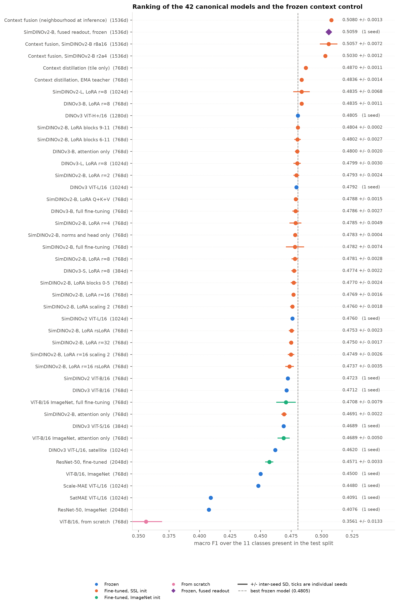
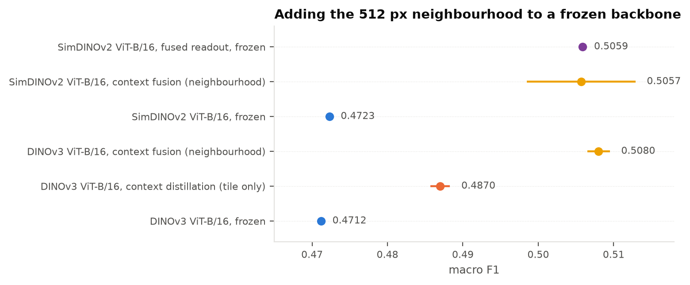
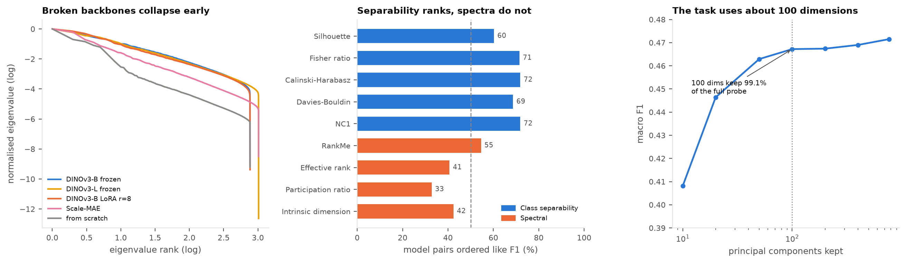
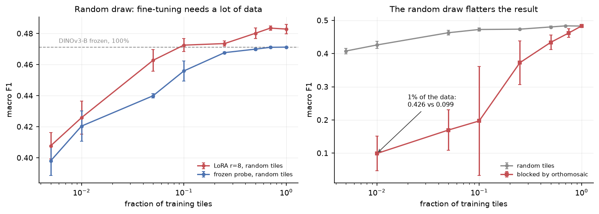

# Arctic tundra vegetation mapping with vision foundation models

Code and results of my Master's project at UQAM. One question: to map Arctic
tundra vegetation from drone imagery, do you need to fine-tune a vision model
on your own data, or is a frozen pretrained model good enough?

Short answer: fine-tuning helps a little. The thing that moves the ceiling is
spatial context, the area around each tile.

## Setup

- Data: Arctic-TVC, 38 drone maps (orthomosaics) at about 2.2 mm per pixel,
  filmed at Trail Valley Creek, Northwest Territories. 35 are annotated with
  vegetation classes. Each whole map goes to train, validation or test, so no
  test tile can leak into training.
- Models: 42 configurations, 11 frozen backbones and 31 fine-tuned ones with
  three seeds each. All use the same linear probe on the embeddings, so the
  score describes the representation, not the head.
- Metric: macro F1 over the 11 classes present in the test split. Three
  classes (ARCA, DRYI, RUBC) score near zero for every model, so the absolute
  numbers are lower than a cleaner benchmark would give.

## Ranking



The top of the table comes from adding the neighbourhood: 0.5080 for context
fusion, 0.5057 for the same idea on SimDINOv2-B. Among single-tile models,
context distillation reaches 0.4870 and DINOv3-L with LoRA reaches 0.4842,
both slightly above the best frozen model, DINOv3-H+/16 at 0.4805.

## What helped

**Spatial context.** Fusing a tile with its 512 px neighbourhood adds 0.025
to 0.034, and it is positive on 8 of the 9 test maps. A frozen SimDINOv2-B
with a fused readout reaches 0.5059 without a single training step.

The controls show that the aligned neighbourhood is what matters, not the
extra pixels: context alone scores 0.4781 against 0.4778 for the tile alone,
and a shuffled context does worse than the tile alone (0.4745). On five frozen
backbones, 512 px beats 1024 px, which beats 2048 px.



**Model size.** LoRA r=8 gains 0.0114 over its own frozen DINOv3-B, but a
bigger frozen model still wins: frozen ViT-L/16 sits 0.004 above frozen
ViT-B/16 on 8 of the 9 sites, and full fine-tuning of the smaller model ends
just below it (0.4786 against 0.4792).

## What did not help

- **More LoRA.** Rank, scaling, block placement and target layers all land
  within 0.0067. Updating only the normalization layers plus the head, 47k
  parameters, is within 0.001 of LoRA rank 8.
- **Other readouts.** Cosine k-NN was 0.031 to 0.104 below the linear probe,
  and MLP, bilinear and FiLM heads were worse in 33 groups out of 33.
- **Texture features.** 106 handcrafted texture variables changed nothing
  (-0.002 to +0.001); the embedding already predicts them. LogME could not
  rank the models.
- **Satellite pretraining.** SatMAE 0.4091, Scale-MAE 0.4480, DINOv3-L
  satellite 0.4620, against 0.4792 for the same architecture trained on
  natural images.
- **Training from scratch.** 0.3561, last of the ranking.

## Latent space



The broken backbones give themselves away without any labels: Scale-MAE and
the from-scratch model lose most of their energy in the first few dozen
directions, while the usable representations keep a long tail.

Inside the competitive tier, only class separability predicts F1. Fisher
ratio, Calinski-Harabasz, NC1 and Davies-Bouldin order 69 to 72 percent of
model pairs like F1 does. The spectral measures do not: effective rank 41
percent, participation ratio 33 percent, RankMe 55 percent, which is chance.

Within a single backbone, across its 12 layers, geometry works again: RankMe
tracks F1 with a Spearman rho of 0.89. It is a good map of where a model sits
along its own depth, and a poor tool for comparing different models at the
top. Keeping 100 principal components reaches 99.1 percent of the full probe
on DINOv3-B; the other 668 dimensions add 0.004.

## Data size and sampling



Fine-tuning a strong backbone costs a lot of data and returns little: LoRA
needs about 4,592 tiles just to match its own frozen baseline and ends only
0.012 above it.

Drawing training tiles at random also makes small-data results look better
than they are. With a spatially blocked draw, performance at 1 percent of the
data falls from 0.426 to 0.099. Part of that is class coverage: at 1 percent
only 3 to 6 classes are present in training, and scoring only those classes
raises it to 0.229.

## What the numbers cannot support

The test set has nine maps. That is few, and it caps what can be claimed.

- A bootstrap over maps widens the 95 percent interval on F1 from 0.0142 to
  0.1788. Paired per-site differences are much tighter, but the smallest
  effect this design can detect is roughly 0.03 to 0.05.
- An earlier version of this README claimed that no pairwise difference
  survived a multiple-test correction. That was an artifact of the bootstrap
  resolution, not a property of the data. The honest reading: the top tier
  cannot be ranked at this sample size.
- The choice of the regularization strength C per seed moves some models by
  about 0.005 (DINOv3-L LoRA reads 0.4842 or 0.4799 depending on it). Treat
  differences that small as not final.
- ARCA, DRYI and RUBC are near zero for every model and RHOL is absent, so
  macro F1 is dragged down for everyone.

## Running it

```bash
pip install -r requirements.txt

python extract.py --config configs/frozen_dinov3_lvd.yaml
python probe.py   --config configs/frozen_eval.yaml
python analyze.py --config configs/frozen_eval.yaml
```

Splits and embeddings are not included; regenerate them with `extract.py`.
Two rules protect the numbers, and `tests/test_repo_guards.py` checks both:
the probe forces single-threaded BLAS (the thread count moves results by
about 0.0015 F1), and every model must use the same 6-point grid
C in {1e-4, 1e-3, 0.01, 0.1, 1, 10}.

`scripts/make_readme_figures.py` regenerates the four figures above.

## Data and licence

Arctic-TVC is public on FRDR:
[doi:10.20383/103.01418](https://doi.org/10.20383/103.01418). Code is MIT,
figures and results are CC-BY-4.0.
