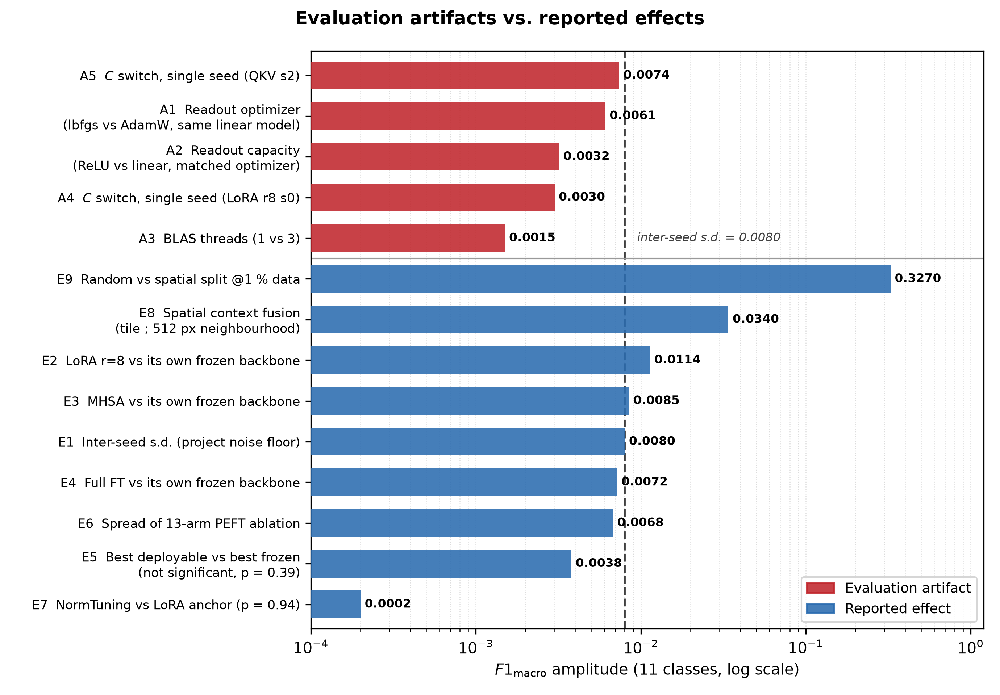
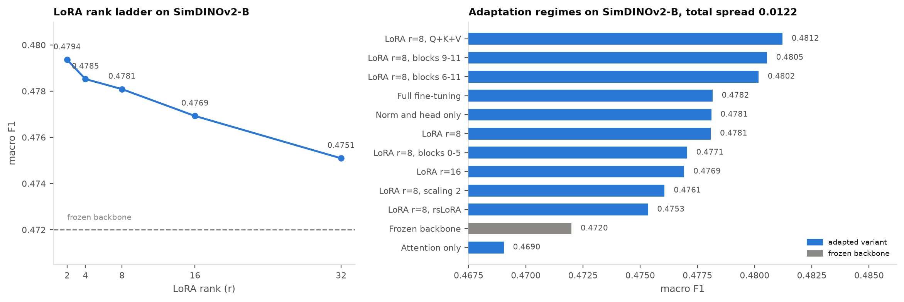
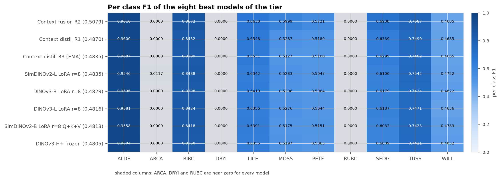
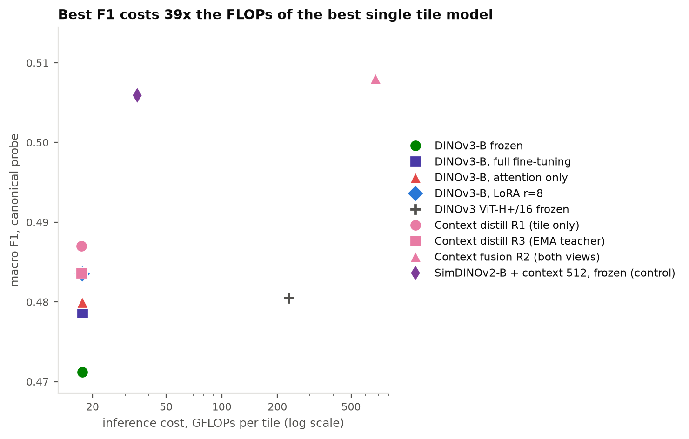

# Arctic-TVC vegetation benchmark

MSc project, UQAM. 42 vision foundation model configurations, 11-class tundra
vegetation mapping from drone orthomosaics, one shared linear probe, one test split.
Headline: the best macro F1 (0.5080) comes from spatial context at inference, not
from training; fine-tuning a strong frozen backbone gains 0.012 or less on a single tile.

## Results at a glance


| Rank | Model | Type | Macro F1 | Seed SD | Embedding |
|---:|---|---|---:|---:|---:|
| 1 | Context fusion R2 (tile + neighbourhood) | fine-tuned, 3 seeds | 0.5080 | 0.0013 | 1536d |
| 2 | Context fusion, SimDINOv2-B r8a16 | fine-tuned, 3 seeds | 0.5057 | 0.0072 | 1536d |
| 3 | Context fusion, SimDINOv2-B r2a4 | fine-tuned, 3 seeds | 0.5030 | 0.0012 | 1536d |
| - | SimDINOv2-B + context 512, frozen | frozen, fused readout | 0.5059 | - (1 seed) | 1536d |
| 4 | Context distillation R1 (tile only at inference) | fine-tuned, 3 seeds | 0.4870 | 0.0011 | 768d |
| 5 | DINOv3-B, LoRA r=8 | fine-tuned, 3 seeds | 0.4835 | 0.0011 | 768d |
| 6 | SimDINOv2-L, LoRA r=8 | fine-tuned, 3 seeds | 0.4835 | 0.0068 | 1024d |
| 7 | Best frozen: DINOv3 ViT-H+/16 | frozen | 0.4805 | - (1 seed) | 1280d |
| - | DINOv3 ViT-L/16, natural images | frozen | 0.4792 | - (1 seed) | 1024d |
| - | DINOv3 ViT-L/16, satellite pretraining | frozen | 0.4620 | - (1 seed) | 1024d |
| - | ViT-B/16, ImageNet | frozen | 0.4500 | - (1 seed) | 768d |
| - | Scale-MAE ViT-L/16 | frozen | 0.4480 | - (1 seed) | 1024d |
| - | SatMAE ViT-L/16 | frozen | 0.4091 | - (1 seed) | 1024d |
| - | ViT-B/16, trained from scratch | from scratch, 3 seeds | 0.3561 | 0.0133 | 768d |

Full 42-model registry: `results/all_models_canonical_merged.json` (44 entries, the
2 invalid ExPLoRA runs excluded from every published number).
DINOv3-L LoRA reads 0.4799 in the registry or 0.4842 with the run's own per-seed C,
see `results/audit_baseline_2026-10-08/BASELINE_ADJUDICATION.md`; differences
below 0.005 are not final.

## Effect sizes against the noise floor



Most PEFT differences sit at or below the inter-seed SD of 0.0080.
The two effects that clearly exceed it: spatial context fusion (+0.034) and random vs
blocked data at 1 % (0.327, mostly class coverage).

## Spatial context (rows 1-4)


| Control | Macro F1 | Reading |
|---|---:|---|
| Tile alone | 0.4778 | baseline |
| Context alone | 0.4781 | the neighbourhood alone adds nothing |
| Shuffled context | 0.4745 | wrong alignment is worse than nothing |
| Tile + aligned context | 0.4781 to 0.5080 by model | only the aligned pair helps |

Gains are +0.025 to +0.034, positive on 8 of 9 test maps. On five frozen backbones,
512 px beats 1024 px beats 2048 px. The frozen fused readout (0.5059) needs no
gradient step at all.

## Fine-tuning and PEFT (rows 5-7)



| Regime on the same backbone | Result |
|---|---|
| LoRA r=8, DINOv3-B | +0.0114 vs its own frozen |
| Attention only (MHSA), DINOv3-B | +0.0085 vs its own frozen |
| Full fine-tuning, ViT-B ImageNet | 0.4786, still under frozen ViT-L at 0.4792 |
| Norm and head only, 47k params | within 0.001 of LoRA r=8 |
| LoRA rank 2 to 32, scaling, blocks, Q+K+V | all inside 0.0067 |

Adaptation is a flat landscape: more rank, more parameters, and later blocks do not
buy measurable accuracy. Size does: frozen ViT-L beats frozen ViT-B by 0.004 on 8 of
9 sites.

## Per class (why the absolute F1 is low)



Three of 11 classes (ARCA, DRYI, RUBC) score near zero for every model, and RHOL is
absent from val and test (0 tiles). Macro F1 is dragged down for everyone; compare
models, not the absolute level.

## Deployment cost



The 0.5080 fusion model costs 39x the FLOPs of the 0.4870 tile-only distillation.
Within the cheap single-tile range (17 GFLOPs), LoRA and distillation are the frontier.

## Latent space: what predicts F1


| Question | Answer | Number |
|---|---|---|
| Which measures rank models by F1 out of sample? | class separability only | 63.5 to 69.4 % of pairs, p(BH) <= 1.3e-4 |
| Spectral measures? | no | RankMe 37.2 %, LogME-train 33.6 %, unstable sign |
| Does geometry work across models at all? | within one backbone only | layerwise RankMe rho = 0.89 vs F1 |
| How much of the embedding is used? | about 100 dims | 100 PCs give 99.1 % of full probe F1, the rest adds 0.004 |
| Spot broken backbones without labels? | yes | Scale-MAE and from-scratch collapse in the first few dozen eigen-directions |

## Data size and sampling


LoRA needs about 4,592 tiles just to match its own frozen baseline, then ends +0.012.
Weaker ImageNet regimes overtake at about 2,060 tiles (+0.025 to +0.028). At 1 % of
the data, a random draw reads 0.426 while a spatially blocked draw reads 0.099 (0.229
when scored only on the 3 to 6 classes present): small-data numbers from random draws
are inflated by coverage, then by spatial leakage.

## Protocol

| Item | Value |
|---|---|
| Data | Arctic-TVC, 38 orthomosaics at about 2.2 mm/px, Trail Valley Creek, NWT; 35 annotated; [doi:10.20383/103.01418](https://doi.org/10.20383/103.01418) |
| Split | whole orthomosaic per side, no tile leakage; 9 test maps; 49,281 train / 17,598 test tiles (11 classes) |
| Readout | multinomial lbfgs, shared grid C in {1e-4, 1e-3, 0.01, 0.1, 1, 10}, best C on val |
| Determinism | seed=42; single-threaded BLAS enforced (thread count is worth about 0.0015 F1) |
| Guards | `tests/test_repo_guards.py`: C grid, threads, deprecated values 0.4675 / 0.4680 / 0.5256 |

## Experiment index (traceability)

| Experiment | Code | Data |
|---|---|---|
| 1. Main ranking, 42 configs | `extract.py`, `probe.py`, `scripts/run_pipeline.py` stage A | `results/all_models_canonical_merged.json` |
| 2-3. Context fusion, sizes, controls | `scripts/context_crop.py`, `context_size_sweep.py`, `context_bouguessa_controls.py`, `scripts/slurm_context_*.sh` | figures above |
| 4. Context distillation | `configs/context_distill_*.yaml`, `scripts/context_distill*.py` | registry |
| 5-6. PEFT and LoRA ablations | `train.py`, `configs/*lora*.yaml`, `ft_*.yaml` | `results/lora_simb_ablation/`, `results/rapport_data/tile_heads/` |
| 7. Readout heads (kNN, MLP, bilinear, FiLM): 0/33 tile beat lbfgs, 2/24 fused, not citable | `scripts/tile_head_sweep.py`, `fusion_head_sweep.py`, `scripts/rapport/head_sweep_summary.py` | `results/rapport_data/head_sweep_summary.{json,csv}` |
| 8. Geometry vs F1, leave-one-model-out | `scripts/rapport/loo_triage.py`, `geometry_test_fixed_n.py` | `results/rapport_data/loo_triage.{json,csv}` |
| 9. Layerwise geometry | `scripts/rapport/layerwise_geometry.py` | `results/rapport_data/layerwise.csv` |
| 10. PCA-truncated probe | `scripts/rapport/dim_probe.py`, `dim_probe_summary.py` | `results/rapport_data/dim_probe_summary.csv` |
| 11. Texture features, 106 vars, gain -0.002 to +0.001 | `src/texture.py`, `scripts/texture_ablation.py`, `texture_redundancy.py` | `results/texture/` |
| 12. LogME, bimodal, cannot rank | `scripts/task_b_logme.py` | `loo_triage.csv` |
| 13-14. Learning curves and sampling | `scripts/datacurve_one_run.py`, `datacurve_aggregate.py`, `configs/*datacurve*` | figure above |
| 15-16. Satellite vs natural, from scratch | `configs/frozen_*.yaml`, `train.py` | registry |
| 17. Significance: 35 groups, 595 pairs, n=10 000, BH, 182 rejections | `scripts/significance_matrix.py`, `scripts/rapport/significance_tier.py`, `task_c_aso.py` | `results/significance_matrix_tier.json`, `significance_matrix_all12.json` |
| 18. Class-schema diagnostics (RHOL) | `scripts/generate_splits_11cls.py` | `results/with_rhol/`, `results/without_rhol/` |
| 19. Per-class F1 and confusion | `scripts/rapport/make_perclass_tier.py`, `knn_and_confusion.py` | `results/rapport_data/per_class_*.csv`, `confusion_*.npz` |
| 20. Consistency, 15/15 machine checks | `scripts/rapport/check_consistency.py` | `results/rapport_data/consistency_report.md` |

Ongoing, not citable: `leo-explora-ssl/` (SSL pretraining exploration, SLURM),
outputs unpublished.

## Limits and withdrawals

- 9 test maps cap the design: bootstrap over maps widens the F1 interval from 0.0142
  to 0.1788; smallest detectable effect about 0.03 to 0.05. An earlier claim here
  ("no difference survives correction") was a test artifact, not a finding: the top
  tier simply cannot be ranked at this n.
- Per-seed C selection moves some models by about 0.005.
- Deprecated single-seed fine-tunes and the invalid ExPLoRA runs are excluded
  everywhere; the guard test forbids 0.4675 / 0.4680 / 0.5256.

## Reproduce

```bash
pip install -r requirements.txt
# gated: HF access to facebook/dinov3-*-lvd1689m; and
# pip install git+https://github.com/ilyassmoummad/sslplant  (SimDINOv2)

python scripts/generate_splits_11cls.py
python extract.py --config configs/frozen_dinov3_lvd.yaml
python probe.py   --config configs/frozen_eval.yaml
python analyze.py --config configs/frozen_eval.yaml

make paper        # pipeline A-F, deterministic
make probe | latent | sig | transfer | figures | tables
python scripts/make_readme_figures.py   # all README figures
```

Embeddings and splits are not in the repo (size). Arctic-TVC is public on FRDR.
Code MIT, figures and results CC-BY-4.0.
