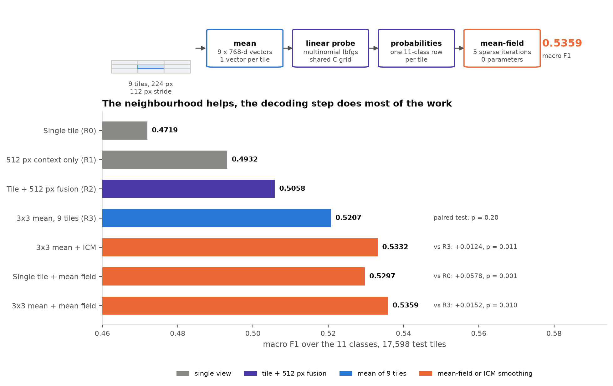
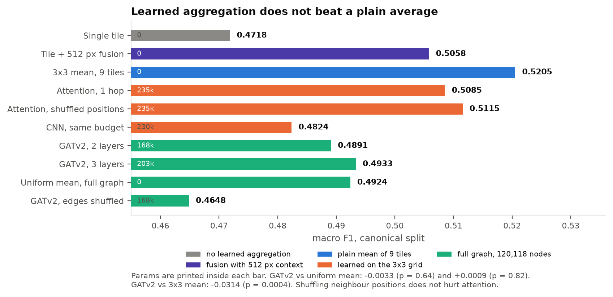
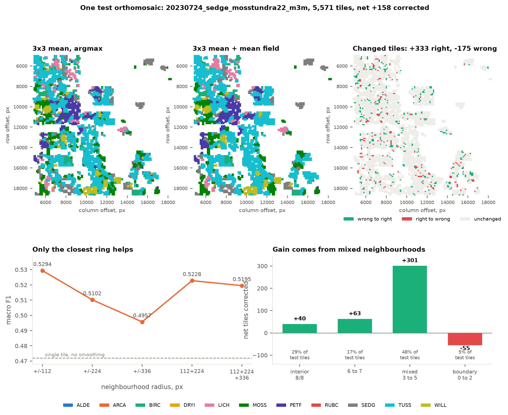
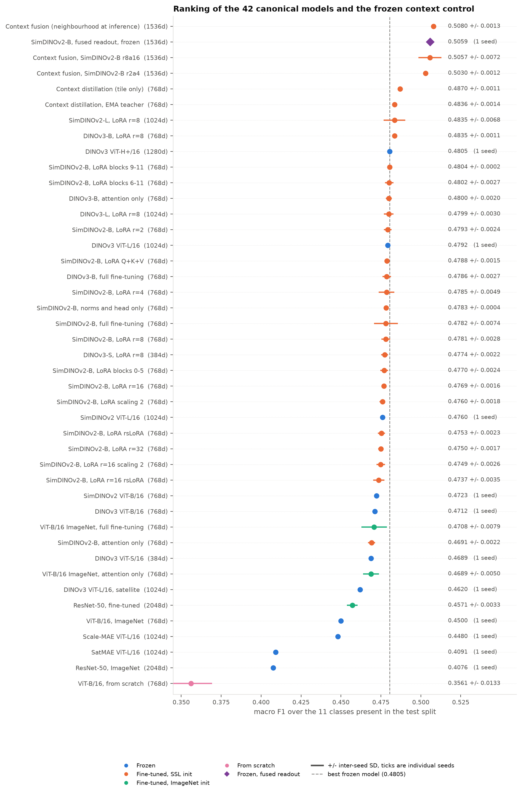
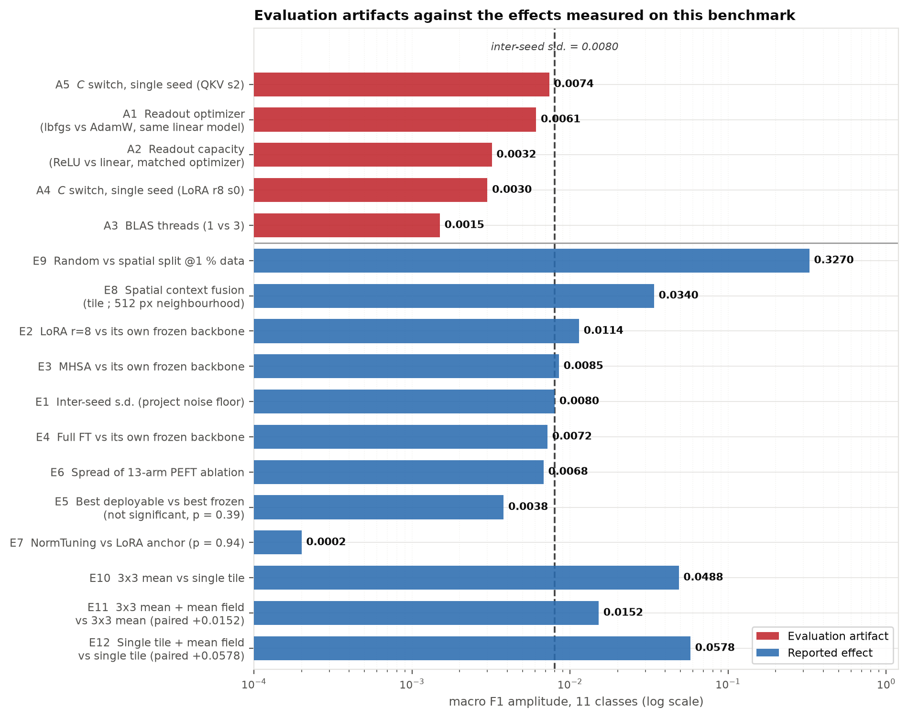
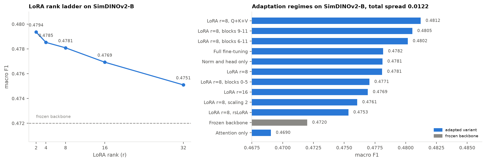
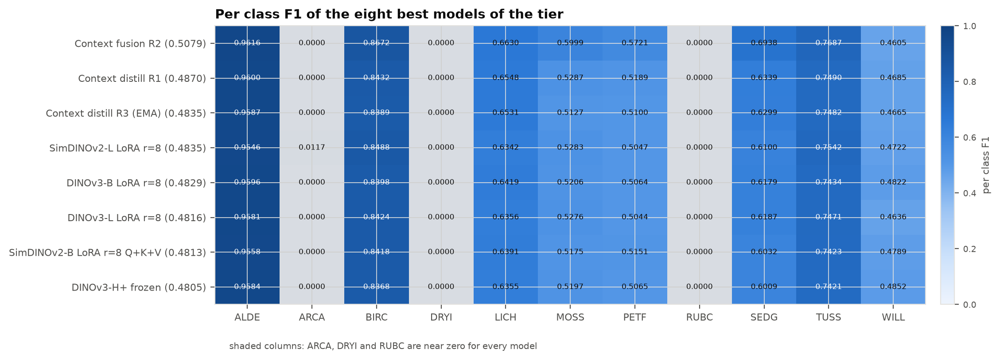
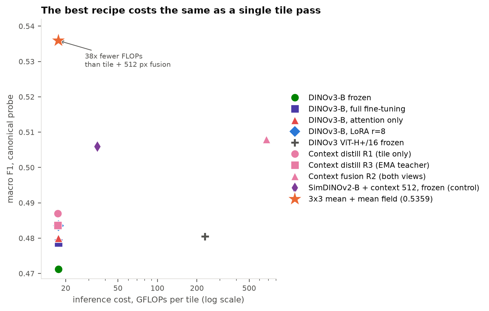
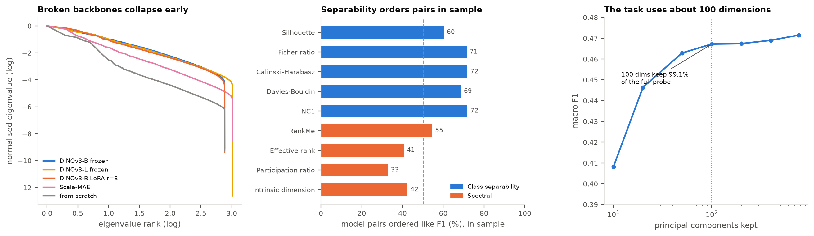
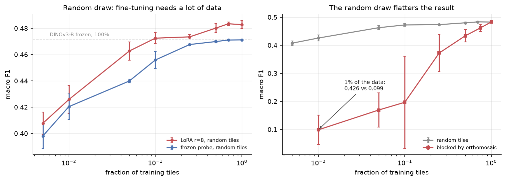

# Arctic-TVC vegetation benchmark

MSc project, UQAM. 42 vision foundation model configurations for 11-class tundra
vegetation mapping from drone orthomosaics, one shared linear probe, one test split.

Headline: 0.5359 macro F1 on the canonical test split with a frozen SimDINOv2-B/16,
a 3x3 average of neighbouring tile embeddings and mean-field smoothing of the predicted
map. That is +0.064 over the same backbone on a single tile, with no training and no new
parameters. A learned GATv2 on the same tile graph does not beat the plain average.

## Tile averaging and decoding



| Recipe | Macro F1 | Paired delta | 95% CI | p |
|---|---:|---:|---|---:|
| Single tile (R0) | 0.4719 | | | |
| 512 px context only (R1) | 0.4932 | | | |
| Tile + 512 px fusion (R2) | 0.5058 | | | |
| 3x3 mean of 9 tiles (R3) | 0.5207 | +0.0136 vs R2 | [-0.0320, +0.0360] | 0.20 |
| 3x3 mean + ICM | 0.5332 | +0.0124 vs R3 | [+0.0043, +0.0583] | 0.011 |
| Single tile + mean field | 0.5297 | +0.0578 vs R0 | [+0.0429, +0.1217] | 0.0012 |
| 3x3 mean + mean field | 0.5359 | +0.0152 vs R3 | [+0.0058, +0.0622] | 0.010 |

All rows use the same frozen SimDINOv2-B/16 features and the canonical probe. Deltas are
paired hierarchical bootstrap over the 9 test orthomosaics, 10,000 replicates.

Reading:

- R3 is the best feature arm. It is not separable from R2 at 9 test maps: the paired
  delta is +0.0136 and its CI crosses zero. The pooled gap is +0.0149.
- On top of the feature ladder, smoothing is the only addition whose CI excludes zero.
  It gives +0.058 on a single tile and +0.015 on the 3x3 mean.
- After smoothing, the single tile reaches the 3x3 mean (0.5297 against 0.5359, +0.0062,
  p = 0.28). The neighbourhood mostly votes on spatially correlated errors:
  centre-neighbour cosine is 0.831 +/- 0.093.
- Cost is one embedding pass per tile, neighbours read from cache, then 5 sparse
  iterations. No parameters, no training.

## Learned aggregation does not help



| Arm | Parameters | Macro F1 |
|---|---:|---:|
| Single tile | 0 | 0.4718 |
| Tile + 512 px fusion | 0 | 0.5058 |
| 3x3 mean, annotated tiles only | 0 | 0.5205 |
| Attention, 1 hop | 235k | 0.5085 |
| Attention, shuffled positions | 235k | 0.5115 |
| CNN, same parameter budget | 230k | 0.4824 |
| GATv2, 2 layers | 168k | 0.4891 |
| GATv2, 3 layers | 203k | 0.4933 |
| Uniform mean, full graph | 0 | 0.4924 |
| GATv2, edges shuffled | 168k | 0.4648 |

- GATv2 equals the uniform mean on the same graph: -0.0033 (p = 0.64) for 2 layers,
  +0.0009 (p = 0.82) for 3 layers.
- GATv2 is below the 3x3 mean on annotated tiles: -0.0314 (p = 0.0004).
- Shuffling neighbour positions does not hurt the attention model (0.5115 against
  0.5085). The spatial arrangement is not used.
- Adding the 40,030 unannotated windows to the graph costs 0.0281 (p < 0.001).
  These windows do not carry the same class mix, so more context is not better context.
- A pre-registered pilot on 17 orthomosaics reached the same verdict: learned attention
  0.3822 against 0.3782 for fixed context, +0.0041, CI [-0.019, +0.024], under the
  +0.010 threshold. The extension to 32 orthomosaics was stopped.

The pilot F1 values come from a reduced, unbalanced split and must not be compared with
0.5059. R3 reads 0.5205 in the GNN run and 0.5207 in the decoding run, a 0.0002
numerical-path difference. Comparisons are paired within each run.

## Where smoothing acts



Same probabilities, only the tile graph changes. All rows are a single tile plus
mean-field smoothing at the stated radius.

| Neighbourhood | Mean neighbours | Macro F1 |
|---|---:|---:|
| +/-112 px (50% overlap) | 6.69 | 0.5294 |
| +/-224 px | 5.67 | 0.5102 |
| +/-336 px | 4.90 | 0.4957 |
| +/-112 and +/-224 | 12.36 | 0.5228 |
| all three rings | 17.26 | 0.5195 |

| Stratum, same-label neighbours out of 8 | Share of test | Net tiles corrected |
|---|---:|---:|
| interior, 8/8 | 29.1% | +40 |
| 6 to 7 | 17.4% | +63 |
| mixed, 3 to 5 | 48.0% | +301 |
| boundary, 0 to 2 | 5.5% | -55 |

- 301 of the 349 net corrections come from mixed neighbourhoods, not annotation
  interiors. The gain is not a polygon-geometry artifact.
- True boundaries lose 0.057 accuracy. A contrast-weighted CRF does not fix this:
  the best weighted setting reads 0.5335 against 0.5352 for the uniform graph, and
  the result degrades monotonically with contrast.
- 58 colour and texture descriptors reach 0.1412 alone and lower every ViT arm by
  0.004 to 0.005 when concatenated.
- Pseudo-labelling the 40,030 unannotated windows peaks at 0.4943, below 0.5207.

## Model ranking



The table ranks backbone configurations with the single-tile probe. The readout recipes
above are post-processing and are not part of the 42-model registry.

| Rank | Model | Type | Macro F1 | Seed SD | Embedding |
|---:|---|---|---:|---:|---:|
| 1 | Context fusion R2 (tile + neighbourhood) | fine-tuned, 3 seeds | 0.5080 | 0.0013 | 1536d |
| 2 | Context fusion, SimDINOv2-B r8a16 | fine-tuned, 3 seeds | 0.5057 | 0.0072 | 1536d |
| 3 | Context fusion, SimDINOv2-B r2a4 | fine-tuned, 3 seeds | 0.5030 | 0.0012 | 1536d |
| - | SimDINOv2-B + context 512, frozen | frozen, fused readout | 0.5059 | - (1 seed) | 1536d |
| 4 | Context distillation R1 (tile only at inference) | fine-tuned, 3 seeds | 0.4870 | 0.0011 | 768d |
| 5 | DINOv3-B, LoRA r=8 | fine-tuned, 3 seeds | 0.4835 | 0.0011 | 768d |
| 6 | SimDINOv2-L, LoRA r=8 | fine-tuned, 3 seeds | 0.4835 | 0.0068 | 1024d |
| 7 | Best frozen: DINOv3 ViT-H+/16 | frozen | 0.4805 | - (1 seed) | 1280d |
| - | DINOv3 ViT-L/16, natural images | frozen | 0.4792 | - (1 seed) | 1024d |
| - | DINOv3 ViT-L/16, satellite pretraining | frozen | 0.4620 | - (1 seed) | 1024d |
| - | ViT-B/16, ImageNet | frozen | 0.4500 | - (1 seed) | 768d |
| - | Scale-MAE ViT-L/16 | frozen | 0.4480 | - (1 seed) | 1024d |
| - | SatMAE ViT-L/16 | frozen | 0.4091 | - (1 seed) | 1024d |
| - | ViT-B/16, trained from scratch | from scratch, 3 seeds | 0.3561 | 0.0133 | 768d |

Full 42-model registry: `results/all_models_canonical_merged.json` (44 entries, the
2 invalid ExPLoRA runs excluded from every published number).
DINOv3-L LoRA reads 0.4799 in the registry or 0.4842 with the run's own per-seed C,
see `results/audit_baseline_2026-10-08/BASELINE_ADJUDICATION.md`; differences
below 0.005 are not final.

## Effect sizes against the noise floor



Most PEFT differences sit at or below the inter-seed SD of 0.0080.
The effects that clearly exceed it: mean-field smoothing (+0.0578 on a single tile,
+0.0152 on the 3x3 mean) and random vs blocked data at 1% (0.327, mostly class
coverage). The 3x3 mean over the earlier fusion is not separable at 9 test maps:
+0.0149 pooled, +0.0136 paired, CI [-0.032, +0.036].

## Fine-tuning and PEFT



| Regime on the same backbone | Result |
|---|---|
| LoRA r=8, DINOv3-B | +0.0114 vs its own frozen |
| Attention only (MHSA), DINOv3-B | +0.0085 vs its own frozen |
| Full fine-tuning, ViT-B ImageNet | 0.4786, still under frozen ViT-L at 0.4792 |
| Norm and head only, 47k params | within 0.001 of LoRA r=8 |
| LoRA rank 2 to 32, scaling, blocks, Q+K+V | all inside 0.0067 |

Adaptation is a flat landscape: more rank, more parameters and later blocks do not buy
measurable accuracy. Size does: frozen ViT-L beats frozen ViT-B by 0.004 on 8 of
9 sites.

## Per class (why the absolute F1 is low)



Three of 11 classes (ARCA, DRYI, RUBC) score near zero for every model, and RHOL is
absent from val and test (0 tiles). Macro F1 is dragged down for everyone; compare
models, not the absolute level.

## Deployment cost



The 0.5359 recipe embeds each tile once, reuses the eight neighbours from a cache and
runs five sparse mean-field iterations. It costs the same 17.6 GFLOPs per tile as a
single-tile model. Tile + 512 px fusion costs 675.8 GFLOPs, 38x more, for 0.030 less F1.

## Latent space: what predicts F1



| Question | Answer | Number |
|---|---|---|
| Which measures rank models by F1 out of sample? | class separability only | 63.5 to 69.4% of pairs, p(BH) <= 1.3e-4 |
| Spectral measures? | no | RankMe 37.2%, LogME-train 33.6%, unstable sign |
| Does geometry work across models at all? | within one backbone only | layerwise RankMe rho = 0.89 vs F1 |
| How much of the embedding is used? | about 100 dims | 100 PCs give 99.1% of full probe F1, the rest adds 0.004 |
| Spot broken backbones without labels? | yes | Scale-MAE and from-scratch collapse in the first few dozen eigen-directions |

The figure panel reports in-sample pair ordering on the 34 models that have both
geometry and F1. The table reports the leave-one-model-out validation of the same
metrics on the 35-model tier.

## Data size and sampling



LoRA needs about 4,592 tiles just to match its own frozen baseline, then ends +0.012.
Weaker ImageNet regimes overtake at about 2,060 tiles (+0.025 to +0.028). At 1% of
the data, a random draw reads 0.426 while a spatially blocked draw reads 0.099 (0.229
when scored only on the 3 to 6 classes present): small-data numbers from random draws
are inflated by coverage, then by spatial leakage.

## Protocol

| Item | Value |
|---|---|
| Data | Arctic-TVC, 38 orthomosaics at about 2.2 mm/px, Trail Valley Creek, NWT; 35 annotated; [doi:10.20383/103.01418](https://doi.org/10.20383/103.01418) |
| Split | whole orthomosaic per side, no tile leakage; 32 orthomosaics (15 train / 8 val / 9 test); 49,281 / 13,209 / 17,598 tiles, 11 classes |
| Readout | multinomial lbfgs, shared grid C in {1e-4, 1e-3, 0.01, 0.1, 1, 10}, best C on val |
| Smoothing | Potts mean field or ICM on the tile graph, beta and iterations chosen on val, no ground truth labels in the graph |
| Determinism | seed=42; single-threaded BLAS enforced (thread count is worth about 0.0015 F1) |
| Guards | `tests/test_repo_guards.py`: C grid, threads, deprecated values 0.4675 / 0.4680 / 0.5256 |

## Experiment index (traceability)

| Experiment | Code | Data |
|---|---|---|
| 1. Main ranking, 42 configs | `extract.py`, `probe.py`, `scripts/run_pipeline.py` stage A | `results/all_models_canonical_merged.json` |
| 2-3. Context fusion, sizes, controls | `scripts/context_crop.py`, `context_size_sweep.py`, `context_bouguessa_controls.py`, `scripts/slurm_context_*.sh` | figures above |
| 4. Context distillation | `configs/context_distill_*.yaml`, `scripts/context_distill*.py` | registry |
| 5-6. PEFT and LoRA ablations | `train.py`, `configs/*lora*.yaml`, `ft_*.yaml` | `results/lora_simb_ablation/`, `results/rapport_data/tile_heads/` |
| 7. Readout heads (kNN, MLP, bilinear, FiLM): 0/33 tile beat lbfgs, 2/24 fused, not citable | `scripts/tile_head_sweep.py`, `fusion_head_sweep.py`, `scripts/rapport/head_sweep_summary.py` | `results/rapport_data/head_sweep_summary.{json,csv}` |
| 8. Geometry vs F1, leave-one-model-out | `scripts/rapport/loo_triage.py`, `geometry_test_fixed_n.py` | `results/rapport_data/loo_triage.{json,csv}` |
| 9. Layerwise geometry | `scripts/rapport/layerwise_geometry.py` | `results/rapport_data/layerwise.csv` |
| 10. PCA-truncated probe | `scripts/rapport/dim_probe.py`, `dim_probe_summary.py` | `results/rapport_data/dim_probe_summary.csv` |
| 11. Texture features, 106 vars, gain -0.002 to +0.001 | `src/texture.py`, `scripts/texture_ablation.py`, `texture_redundancy.py` | `results/texture/` |
| 12. LogME, bimodal, cannot rank | `scripts/task_b_logme.py` | `loo_triage.csv` |
| 13-14. Learning curves and sampling | `scripts/datacurve_one_run.py`, `datacurve_aggregate.py`, `configs/*datacurve*` | figure above |
| 15-16. Satellite vs natural, from scratch | `configs/frozen_*.yaml`, `train.py` | registry |
| 17. Significance: 35 groups, 595 pairs, n=10 000, BH, 182 rejections | `scripts/significance_matrix.py`, `scripts/rapport/significance_tier.py`, `task_c_aso.py` | `results/significance_matrix_tier.json`, `significance_matrix_all12.json` |
| 18. Class-schema diagnostics (RHOL) | `scripts/generate_splits_11cls.py` | `results/with_rhol/`, `results/without_rhol/` |
| 19. Per-class F1 and confusion | `scripts/rapport/make_perclass_tier.py`, `knn_and_confusion.py` | `results/rapport_data/per_class_*.csv`, `confusion_*.npz` |
| 20. Consistency, 15/15 machine checks | `scripts/rapport/check_consistency.py` | `results/rapport_data/consistency_report.md` |
| 21. 3x3 tile averaging, mean field and ICM | `research/gnn_grid_2026-10-31/code/label_smoothing.py`, `decoding_ablation.py` | `results/tile_context_2026-11-01/recipe_*.json` |
| 22. Neighbourhood scale | `research/gnn_grid_2026-10-31/code/decoding_scales.py` | `results/tile_context_2026-11-01/neighbourhood_scale.json` |
| 23. Attention and GATv2 on the tile graph, pilot and canonical | `research/gnn_grid_2026-10-31/code/run_arms.py`, `run_gnn.py` | `results/tile_context_2026-11-01/gnn_canonical.json` |
| 24. Strata, colour, pseudo-labels, weighted CRF | `code/strata_diagnostic.py`, `extract_color.py`, `pseudo_label.py`, `weighted_smoothing.py` | `results/tile_context_2026-11-01/{strata,color_fusion,pseudo_labels,weighted_crf}.json` |

Ongoing, not citable: `leo-explora-ssl/` (SSL pretraining exploration, SLURM),
outputs unpublished.

## Limits and withdrawals

- 9 test maps cap the design: bootstrap over maps widens the F1 interval from 0.0142
  to 0.1788; smallest detectable effect about 0.03 to 0.05. An earlier claim here
  ("no difference survives correction") was a test artifact, not a finding: the top
  tier simply cannot be ranked at this n.
- Per-seed C selection moves some models by about 0.005.
- Smoothing and GATv2 were measured on one frozen backbone (SimDINOv2-B/16). The
  smoothing gain on fine-tuned or other frozen backbones is not measured.
- The GNN pilot used 17 orthomosaics and 16,699 training tiles. Its absolute F1
  values are not comparable to the canonical 49,281-tile split.
- Deprecated single-seed fine-tunes and the invalid ExPLoRA runs are excluded
  everywhere; the guard test forbids 0.4675 / 0.4680 / 0.5256.

## Reproduce

```bash
pip install -r requirements.txt
# gated: HF access to facebook/dinov3-*-lvd1689m; and
# pip install git+https://github.com/ilyassmoummad/sslplant  (SimDINOv2)

python scripts/generate_splits_11cls.py
python extract.py --config configs/frozen_dinov3_lvd.yaml
python probe.py   --config configs/frozen_eval.yaml
python analyze.py --config configs/frozen_eval.yaml

make paper        # pipeline A-F, deterministic
make probe | latent | sig | transfer | figures | tables
python scripts/make_readme_figures.py          # ranking, PEFT, latent, cost
python scripts/make_readme_context_figures.py  # recipes, GNN, smoothing
```

The tile-context pipeline is in `research/gnn_grid_2026-10-31/`. The pre-registration
and the two negative reports stay local; the scalar outputs are copied under
`results/tile_context_2026-11-01/` with their provenance.

Embeddings and splits are not in the repo (size). Arctic-TVC is public on FRDR.
Code MIT, figures and results CC-BY-4.0.
