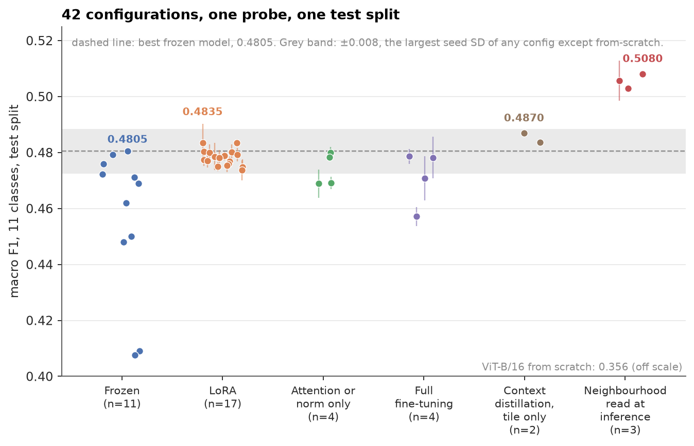
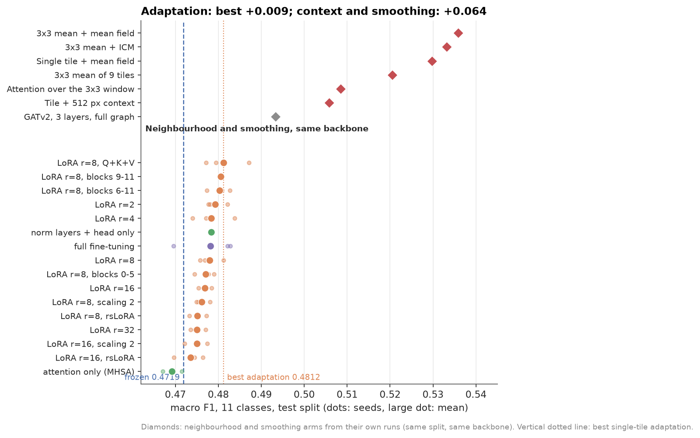
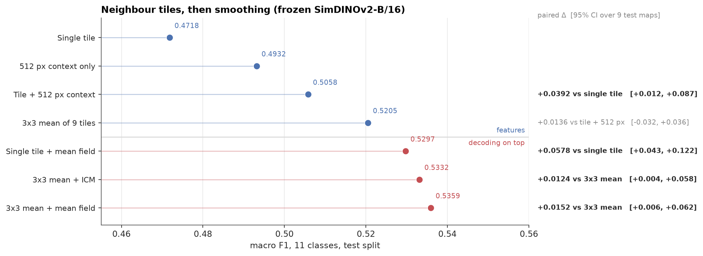
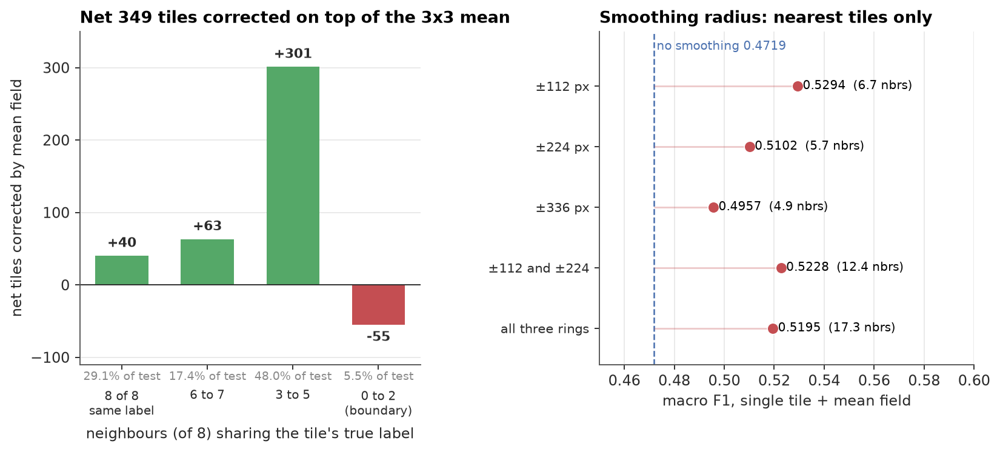
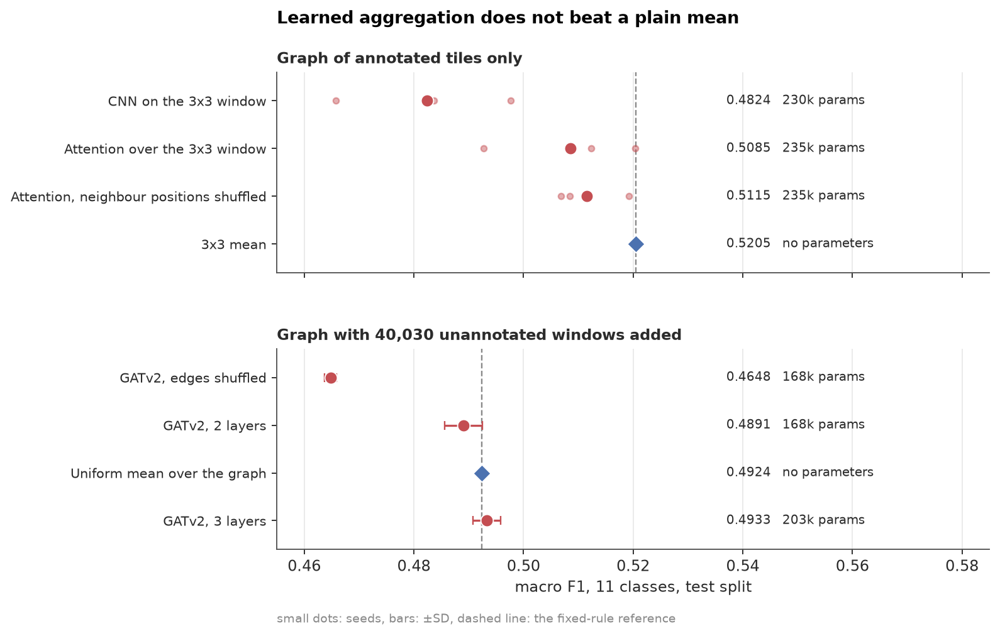
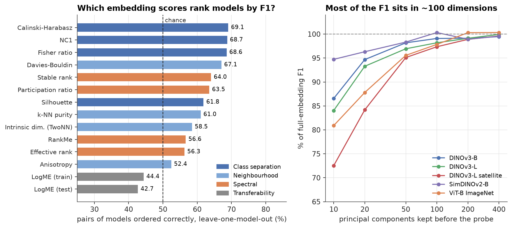
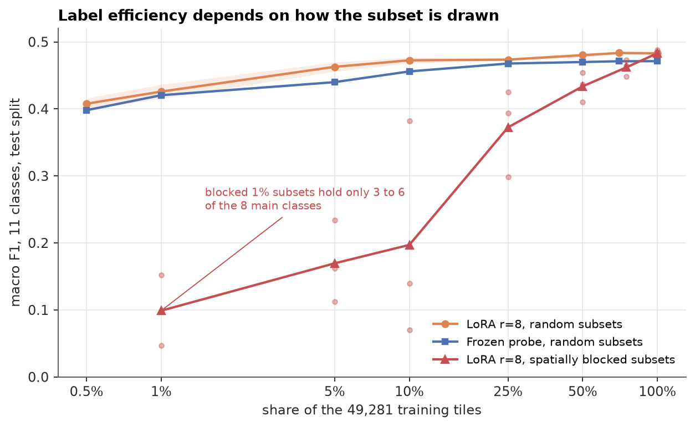

# Arctic-TVC: foundation models for tundra vegetation mapping

MSc project in computer science (AI), UQAM. Supervisors: Mohamed Bouguessa (ML) and Etienne Laliberté (ecology).

The task is to label 224 px tiles cut from drone orthomosaics of arctic tundra (about 2.2 mm/px) into 11 vegetation classes. I use frozen or lightly adapted vision foundation models, one shared linear probe and one test split, and ask what actually improves the map: a better backbone, fine-tuning, or the tiles around each tile.

What I found:

- Among DINOv3 and SimDINOv2 backbones, backbone size and adaptation method move macro F1 by roughly 0.01 to 0.015, close to seed noise. Weaker pretraining (ImageNet, satellite, scratch) is clearly worse.
- Using neighbouring tiles moves it by 0.03 to 0.06, and it needs no training.
- Learned aggregation of neighbours (attention, GATv2) does not beat a plain average.
- Embedding geometry can rank models somewhat better than chance, but it does not predict F1.

Best result: **0.5359 macro F1** with a frozen SimDINOv2-B/16, a 3x3 average of tile embeddings and mean-field smoothing of the predicted map. The same backbone on a single tile reads 0.4719, so the gain is +0.064. The best frozen single-tile model reads 0.4805.

Contents: [Benchmark](#benchmark-of-42-configurations) · [Adaptation](#adaptation-methods) · [Context and smoothing](#neighbouring-tiles-and-smoothing) · [Learned aggregation](#learned-aggregation) · [Embedding geometry](#embedding-geometry) · [Data size](#data-size) · [Per class](#per-class) · [Protocol](#protocol) · [Ongoing](#ongoing-work) · [Limits](#limits) · [Reproduce](#reproduce)

## Benchmark of 42 configurations



11 frozen models and 31 fine-tuned ones (3 seeds each), all read with the same linear probe.

- Best frozen model: DINOv3 ViT-H+/16, 0.4805. Best LoRA: 0.4835. That is +0.003, smaller than the seed band.
- DINOv3-L with LoRA reads 0.4799 in the registry and 0.4842 when C is selected on the full training set. The registry value is used here. Differences under 0.005 are not final.
- Satellite pretraining does not help. DINOv3 ViT-L trained on satellite images reads 0.4620 against 0.4792 for the natural-image version. Scale-MAE reads 0.4480 and SatMAE 0.4091, against 0.4500 for ViT-B/16 ImageNet.
- A ViT-B/16 trained from scratch reads 0.3561.
- Only models that read the neighbourhood at inference leave the band (0.5030 to 0.5080).
- Non-linear readouts (kNN, MLP, bilinear, FiLM) never beat the linear probe on tile features (0 of 33 groups, mean delta -0.0103). They do on 2 of 24 fused groups.

The grey band is a seed measure only. Test-set noise over 9 maps is larger (see [Limits](#limits)).

## Adaptation methods



16 ways to adapt SimDINOv2-B/16 end between 0.4691 and 0.4804. Frozen is 0.4723.

- LoRA rank 2 to 32 spans 0.4750 to 0.4793 and slightly decreases with rank.
- Training only the norm layers and the head (0.4783) matches LoRA r=8 (0.4781) and full fine-tuning (0.4782).
- Full fine-tuning has the largest seed spread: 0.4696 to 0.4829 over 3 seeds.
- Attention-only tuning ends below frozen (0.4691).

## Neighbouring tiles and smoothing



All rows use the same frozen SimDINOv2-B/16 embeddings and the canonical probe. Deltas are paired, bootstrapped over the 9 test orthomosaics, 10,000 replicates.

- Adding context tiles raises F1 from 0.4718 to 0.5205. The step from tile + 512 px context to the 3x3 mean (+0.0136) is not separable from zero at 9 test maps.
- Mean-field smoothing of the predicted map is the clearest single gain: +0.0578 on a single tile, +0.0152 on top of the 3x3 mean. Both intervals exclude zero.
- After smoothing, the 3x3 mean adds little over a single tile: +0.0062, CI [-0.010, +0.053].
- Smoothing needs no parameters and no training. Neighbour embeddings come from a cache.
- Colour and texture descriptors concatenated to the embedding lower F1 by about 0.004.



- 301 of the 349 net corrected tiles sit in mixed neighbourhoods (3 to 5 of 8 neighbours share the label). Tiles on true boundaries lose (-55).
- The nearest ring works best (tiles are 224 px, stride 112, so ±112 px is 50% overlap): 0.5294, against 0.5102 at ±224 px and 0.4957 at ±336 px. Combining rings (0.5195 to 0.5228) does not beat the nearest ring alone.

## Learned aggregation



- Attention over the 3x3 window reads 0.5085 (seeds 0.4928 to 0.5204) against 0.5205 for the mean: -0.012, CI [-0.044, +0.002].
- Shuffling the neighbour positions does not hurt attention (0.5115). The spatial layout is not used.
- GATv2 matches a uniform mean on the same graph: -0.0033 (p = 0.64) with 2 layers, +0.0009 (p = 0.82) with 3 layers.
- GATv2 does use the edges: rewiring them costs 0.024 (CI [+0.014, +0.033]). A plain mean already captures that information.
- Adding 40,030 unannotated windows to the graph lowers the uniform mean by 0.028 against the annotated-only 3x3 mean. More context was not better context.

## Embedding geometry



Left: for 35 models, how often a score orders two models like their F1 does, with the sign and fit learned on the other 34 models.

- Cluster separation scores do best: Fisher ratio 69.4%, Davies-Bouldin 67.4%, NC1 and Calinski-Harabasz 66.9%, silhouette 63.5%. Chance is 50%.
- Spectral scores are weaker (RankMe and the effective rank family, 59.5% at most). RankMe (37.2%) and LogME on train (33.6%) fall below chance because the sign learned on other models flips.
- These scores rank, they do not predict: the error gain over predicting the mean F1 is about 0.0004 at best, on a tier whose F1 range is about 0.04.
- Pairs share models, so they are not independent. The p-values come from a per-model Wilcoxon test with Benjamini-Hochberg correction inside each family, not from the pair count.

Right: keeping 100 principal components recovers 97.4% to 100.3% of the full-embedding F1 for 5 backbones.

## Data size



- LoRA is above the frozen probe at every fraction (+0.005 to +0.023). With 10% of the tiles LoRA reads 0.4725, about the frozen probe on all tiles (0.4712).
- Spatially blocked subsets are far worse than random ones: 0.099 against 0.426 at 1%, 0.434 against 0.480 at 50%. Blocked 1% subsets contain only 3 to 6 of the 8 main classes, so most of that gap is class coverage. I did not separate it from spatial leakage.

## Per class

| Class | Train tiles | Test tiles | Frozen DINOv3-H+ | Context fusion (fine-tuned) |
|---|---:|---:|---:|---:|
| ALDE | 5,285 | 1,884 | 0.958 | 0.962 |
| ARCA | 88 | 113 | 0.000 | 0.000 |
| BIRC | 12,845 | 4,937 | 0.837 | 0.867 |
| DRYI | 390 | 177 | 0.000 | 0.000 |
| LICH | 5,334 | 1,615 | 0.636 | 0.663 |
| MOSS | 5,089 | 1,935 | 0.520 | 0.600 |
| PETF | 1,990 | 1,037 | 0.506 | 0.572 |
| RUBC | 330 | 31 | 0.000 | 0.000 |
| SEDG | 5,250 | 2,134 | 0.601 | 0.694 |
| TUSS | 8,306 | 3,189 | 0.742 | 0.769 |
| WILL | 4,374 | 546 | 0.485 | 0.460 |

Three classes score zero for these two models. ARCA reaches at most 0.056 for any of the 33 models in `per_class_tier.csv`, DRYI and RUBC stay at exactly 0. They are the rarest classes, which pulls macro F1 down for every model, so compare models rather than reading the absolute level. A twelfth class, RHOL, is absent from val and test and is dropped.

## Protocol

| Item | Value |
|---|---|
| Data | Arctic-TVC, drone orthomosaics at about 2.2 mm/px, Trail Valley Creek, NWT. [doi:10.20383/103.01418](https://doi.org/10.20383/103.01418) |
| Split | By whole orthomosaic, no tile leakage: 15 train, 8 val, 9 test. 49,281 / 13,209 / 17,598 tiles |
| Classes | 11 (RHOL removed). Metric: macro F1 over the 11 classes |
| Probe | Multinomial logistic regression (lbfgs), C in {1e-4, 1e-3, 0.01, 0.1, 1, 10} chosen on val |
| Intervals | Paired hierarchical bootstrap, orthomosaic then tile, 10,000 replicates |
| Determinism | seed 42, single-thread BLAS (the thread count alone shifts F1 by about 0.0015) |

## Ongoing work

I am extending this toward transferability and alignment of Earth-observation foundation models under spatial and sensor shift.

- A first pilot found that a distribution discrepancy score (MMD, optimal transport) is associated with transfer, and the association replicated in a second experiment. I could not show that it adds value over RankMe, so I do not claim it.
- Training with an alignment loss is on hold until a discrepancy score shows value beyond RankMe.
- First frozen scores for three EO-oriented models are below DINOv3 (0.4805): SigLIP 2 ViT-B/16 0.4475, SatlasPretrain Aerial SwinB 0.4373, C-RADIO v4-H 0.3764. These are single-seed and not in the registry. Satlas normalisation is assumed to be ImageNet, and C-RADIO is run at 224 px instead of its native 512.
- `leo-explora-ssl/` holds exploratory self-supervised pretraining on aerial tiles (ExPLoRA style). No result from it is reported here.

## Limits

- 9 test maps cap what can be shown. Intervals are wide, and the percentile intervals are not centred on the estimate (for example +0.0152 with CI [+0.006, +0.062]). Read them as "excludes zero or not", not as a precision.
- The seed band covers training noise only. Frozen models have one run each.
- Context, smoothing and GATv2 were measured on one frozen backbone, SimDINOv2-B/16. The gain on fine-tuned or other backbones is not measured.
- Per-seed C selection moves some models by about 0.005.
- The 3x3 mean reads 0.5205 in the aggregation run and 0.5207 in the decoding run. Comparisons are paired within a run. In the context figure the first four rows come from the first run and the smoothing rows from the second.
- Invalid ExPLoRA runs and old single-seed fine-tunes are excluded everywhere. `tests/test_repo_guards.py` forbids a few retired values from reappearing.

## Reproduce

```bash
pip install -r requirements.txt
# DINOv3 weights are gated (facebook/dinov3-*-lvd1689m); SimDINOv2 needs
# pip install git+https://github.com/ilyassmoummad/sslplant

python scripts/generate_splits_11cls.py
python extract.py --config configs/frozen_dinov3_lvd.yaml
python probe.py   --config configs/frozen_eval.yaml
python analyze.py --config configs/frozen_eval.yaml

python scripts/make_readme_plots.py   # rebuilds every figure above from results/
```

Code map: `src/` package, `extract.py` / `probe.py` / `train.py` / `analyze.py` entry points, `configs/` YAML, `scripts/` analysis and SLURM jobs, `research/gnn_grid_2026-10-31/code/` tile context, smoothing and GNN experiments, `results/` scalar outputs (registry: `results/all_models_canonical_merged.json`, context experiments: `results/tile_context_2026-11-01/`).

Embeddings and splits are not in the repo because of size. Arctic-TVC is public on FRDR. Code is MIT, figures and results are CC-BY-4.0.
