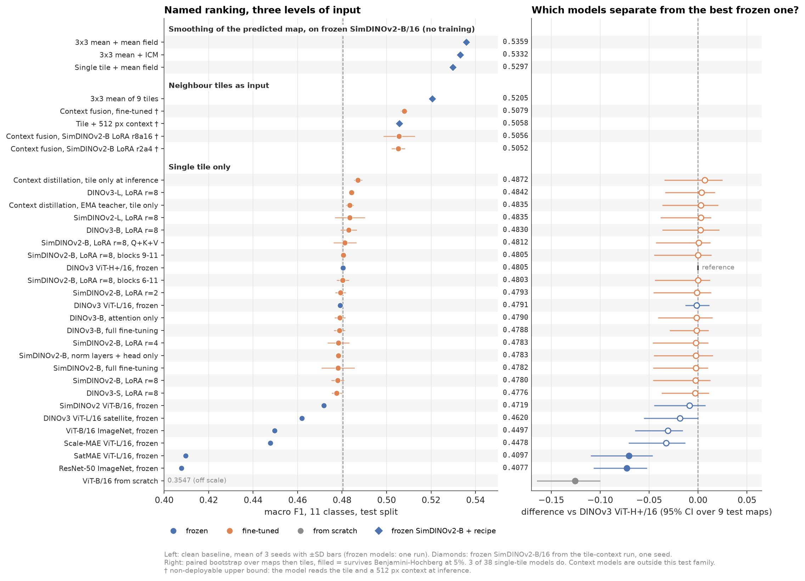
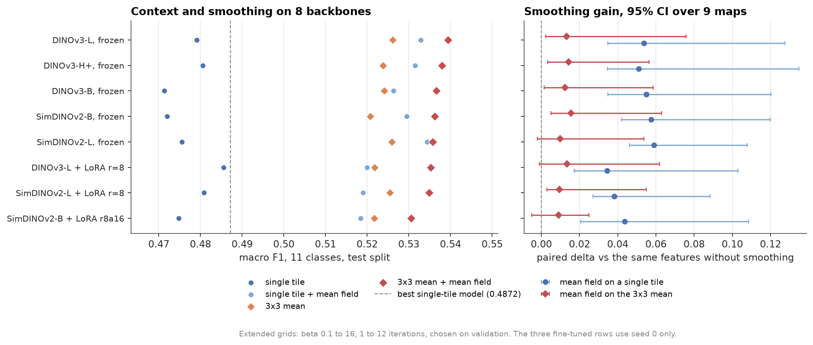
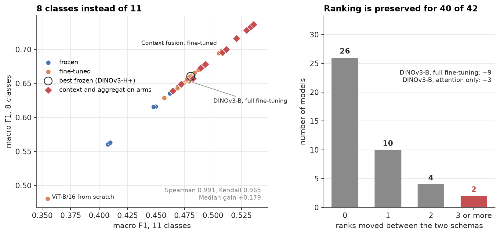

# Arctic-TVC: foundation models for tundra vegetation mapping

MSc project in computer science (AI), UQAM. Supervisors: Mohamed Bouguessa (ML) and Étienne Laliberté (ecology).

The task is to label 224 px tiles cut from drone orthomosaics of arctic tundra (about 2.2 mm/px) into 11 vegetation classes. I use frozen models, parameter-efficient adapters and full fine-tuning, plus a from-scratch control, with one shared linear probe and one test split, and ask what actually improves the map: a better backbone, fine-tuning, or the tiles around each tile.

What I found:

- Among DINOv3 and SimDINOv2 backbones, size and adaptation move macro F1 by 0.015 at most. At 9 test maps none of these differences separates from the best frozen model. Only the weakest backbones do: SatMAE, ResNet-50 ImageNet and ViT-B/16 from scratch.
- Neighbouring tiles move F1 by about 0.04 to 0.06. The smoothing step needs no training; the probe is refit on the aggregated features.
- Learned aggregation of neighbours (attention, GATv2) does not beat a plain average.
- Embedding geometry can rank models somewhat better than chance, but it does not predict F1.

Highest point estimate: **0.5394 macro F1** with a frozen DINOv3-L, a 3x3 average of tile embeddings and mean-field smoothing of the predicted map, across seven backbones with extended grids. The SimDINOv2-B recipe described in detail below reads 0.5359 in its own run (0.5362 in the seven-backbone run), against 0.4720 on a single tile in that same run.

These recipes read neighbouring tiles at inference and are not part of the 42 configurations. Among single-input deployable models, the best is context distillation at 0.4872. The three context-fusion rows (0.5052 to 0.5079) need the tile plus context at inference and are non-deployable upper bounds; the tile + 512 px recipe in the figure is the same kind of arm.

Contents: [Ranking](#ranking-of-42-configurations) · [Adaptation](#adaptation-methods) · [Context and smoothing](#neighbouring-tiles-and-smoothing) · [Other backbones](#does-it-hold-on-other-backbones) · [Learned aggregation](#learned-aggregation) · [Embedding geometry](#embedding-geometry) · [Data size](#data-size) · [Per class](#per-class) · [Protocol](#protocol) · [Ongoing](#ongoing-work) · [Limits](#limits) · [Reproduce](#reproduce)

## Ranking of 42 configurations



42 configurations: 11 frozen and 31 fine-tuned (3 seeds each). 39 are deployable; the other 3 (rows 1 to 3, marked "upper bound" in the table) need the tile plus context at inference. This is the canonical tier of the clean baseline plus those 3 upper bounds; the other 112 registered runs (supporting and exploratory) are not ranked here. Two supporting runs score above the best canonical model and are excluded: a DINOv3-B rank ablation (0.4845) and a single-seed spatial LoRA (0.4885). All are read with the same linear probe. The figure has three levels of input: single tile (top 18 models plus 8 reference points, including the frozen DINOv3-B), neighbour tiles as input, and smoothing of the predicted map. The full list is below.

- Best frozen model: DINOv3 ViT-H+/16, 0.4805. Best plain LoRA in this ranking: DINOv3-L, 0.4842. That is +0.0037, CI [-0.034, +0.017], q = 0.76: not separable.
- Only 3 of 38 single-tile models separate from the best frozen model after Benjamini-Hochberg correction: SatMAE (-0.071), frozen ResNet-50 ImageNet (-0.073) and ViT-B/16 from scratch (-0.126). Everything else fails the correction (q > 0.10). Three of those still have paired intervals excluding zero: ViT-B/16 ImageNet, Scale-MAE and fine-tuned ResNet-50.
- DINOv3 ViT-L on satellite images reads 0.4620 against 0.4791 for the natural-image version of the same model (-0.017, CI [-0.058, +0.001], not separable). Scale-MAE (0.4478) and SatMAE (0.4097) are ViT-L models and read below frozen ViT-B/16 ImageNet (0.4497), a different model size, so they do not isolate the effect of satellite pretraining.
- Fine-tuning on top of the same 512 px fusion does not visibly help: LoRA variants read 0.5056 and 0.5052 (clean baseline) against 0.5058 for the frozen fusion (tile-context run). Different runs, so this is indicative only.
- The fusion and mean arms (0.5052 to 0.5205) sit above every single-tile model; three of them are non-deployable upper bounds. Learned aggregation does not: the CNN reads 0.4824 and GATv2 with shuffled edges 0.4648, both below the best single-tile model. These arms are outside the test family above.
- Non-linear readouts (MLP, bilinear, FiLM) never beat the linear probe on tile features (0 of 33 groups, mean delta -0.0103). They do on 2 of 24 fused groups, both single-seed without intervals, so they are not claimed as gains.

<details>
<summary>All 42 configurations</summary>

| # | Model | Macro F1, 11 classes | Macro F1, 8 classes | Seed SD (11 / 8) | Runs | Deployable |
|---:|---|---:|---:|---:|---:|---|
| 1 | Context fusion, fine-tuned | 0.5079 | 0.6984 | 0.0015 / 0.0020 | 3 | upper bound |
| 2 | Context fusion, SimDINOv2-B LoRA r8a16 | 0.5056 | 0.6953 | 0.0071 / 0.0098 | 3 | upper bound |
| 3 | Context fusion, SimDINOv2-B LoRA r2a4 | 0.5052 | 0.6947 | 0.0030 / 0.0042 | 3 | upper bound |
| 4 | Context distillation, tile only at inference | 0.4872 | 0.6699 | 0.0018 / 0.0025 | 3 | yes |
| 5 | DINOv3-L, LoRA r=8 | 0.4842 | 0.6657 | 0.0012 / 0.0017 | 3 | yes |
| 6 | Context distillation, EMA teacher, tile only | 0.4835 | 0.6648 | 0.0017 / 0.0024 | 3 | yes |
| 7 | SimDINOv2-L, LoRA r=8 | 0.4835 | 0.6633 | 0.0068 / 0.0106 | 3 | yes |
| 8 | DINOv3-B, LoRA r=8 | 0.4830 | 0.6641 | 0.0037 / 0.0051 | 3 | yes |
| 9 | SimDINOv2-B, LoRA r=8, Q+K+V | 0.4812 | 0.6617 | 0.0052 / 0.0072 | 3 | yes |
| 10 | SimDINOv2-B, LoRA r=8, blocks 9-11 | 0.4805 | 0.6608 | 0.0001 / 0.0001 | 3 | yes |
| 11 | DINOv3 ViT-H+/16, frozen | 0.4805 | 0.6606 | n/a / n/a | 1 | yes |
| 12 | SimDINOv2-B, LoRA r=8, blocks 6-11 | 0.4803 | 0.6604 | 0.0028 / 0.0038 | 3 | yes |
| 13 | SimDINOv2-B, LoRA r=2 | 0.4793 | 0.6591 | 0.0024 / 0.0033 | 3 | yes |
| 14 | DINOv3 ViT-L/16, frozen | 0.4791 | 0.6588 | n/a / n/a | 1 | yes |
| 15 | DINOv3-B, attention only | 0.4790 | 0.6572 | 0.0025 / 0.0047 | 3 | yes |
| 16 | DINOv3-B, full fine-tuning | 0.4788 | 0.6535 | 0.0025 / 0.0032 | 3 | yes |
| 17 | SimDINOv2-B, LoRA r=4 | 0.4783 | 0.6577 | 0.0050 / 0.0069 | 3 | yes |
| 18 | SimDINOv2-B, norm layers + head only | 0.4783 | 0.6577 | 0.0002 / 0.0003 | 3 | yes |
| 19 | SimDINOv2-B, full fine-tuning | 0.4782 | 0.6575 | 0.0074 / 0.0102 | 3 | yes |
| 20 | SimDINOv2-B, LoRA r=8 | 0.4780 | 0.6572 | 0.0029 / 0.0039 | 3 | yes |
| 21 | DINOv3-S, LoRA r=8 | 0.4776 | 0.6567 | 0.0023 / 0.0031 | 3 | yes |
| 22 | SimDINOv2-B, LoRA r=8, blocks 0-5 | 0.4771 | 0.6560 | 0.0023 / 0.0032 | 3 | yes |
| 23 | SimDINOv2-B, LoRA r=16 | 0.4769 | 0.6557 | 0.0015 / 0.0021 | 3 | yes |
| 24 | SimDINOv2-B, LoRA r=8, scaling 2 | 0.4761 | 0.6547 | 0.0017 / 0.0023 | 3 | yes |
| 25 | SimDINOv2 ViT-L/16, frozen | 0.4756 | 0.6540 | n/a / n/a | 1 | yes |
| 26 | SimDINOv2-B, LoRA r=8, rsLoRA | 0.4751 | 0.6533 | 0.0020 / 0.0027 | 3 | yes |
| 27 | SimDINOv2-B, LoRA r=32 | 0.4751 | 0.6532 | 0.0018 / 0.0025 | 3 | yes |
| 28 | SimDINOv2-B, LoRA r=16, scaling 2 | 0.4750 | 0.6531 | 0.0026 / 0.0036 | 3 | yes |
| 29 | ViT-B/16 ImageNet, full fine-tuning | 0.4748 | 0.6513 | 0.0015 / 0.0016 | 3 | yes |
| 30 | SimDINOv2-B, LoRA r=16, rsLoRA | 0.4735 | 0.6497 | 0.0035 / 0.0034 | 3 | yes |
| 31 | SimDINOv2 ViT-B/16, frozen | 0.4719 | 0.6488 | n/a / n/a | 1 | yes |
| 32 | DINOv3 ViT-B/16, frozen | 0.4715 | 0.6483 | n/a / n/a | 1 | yes |
| 33 | SimDINOv2-B, attention only (MHSA) | 0.4692 | 0.6430 | 0.0022 / 0.0031 | 3 | yes |
| 34 | DINOv3 ViT-S/16, frozen | 0.4689 | 0.6448 | n/a / n/a | 1 | yes |
| 35 | ViT-B/16 ImageNet, attention only | 0.4686 | 0.6430 | 0.0048 / 0.0082 | 3 | yes |
| 36 | DINOv3 ViT-L/16 satellite, frozen | 0.4620 | 0.6352 | n/a / n/a | 1 | yes |
| 37 | ResNet-50 ImageNet, full fine-tuning | 0.4573 | 0.6287 | 0.0033 / 0.0046 | 3 | yes |
| 38 | ViT-B/16 ImageNet, frozen | 0.4497 | 0.6163 | n/a / n/a | 1 | yes |
| 39 | Scale-MAE ViT-L/16, frozen | 0.4478 | 0.6157 | n/a / n/a | 1 | yes |
| 40 | SatMAE ViT-L/16, frozen | 0.4097 | 0.5633 | n/a / n/a | 1 | yes |
| 41 | ResNet-50 ImageNet, frozen | 0.4077 | 0.5606 | n/a / n/a | 1 | yes |
| 42 | ViT-B/16 from scratch | 0.3547 | 0.4805 | 0.0115 / 0.0067 | 3 | yes |

</details>

## Adaptation methods


16 ways to adapt SimDINOv2-B/16 end between 0.4692 and 0.4812. Frozen is 0.4719. SimDINOv2-B is the workhorse here because it is the only backbone with a full 16-regime ladder in the clean baseline; its frozen score is within 0.0004 of DINOv3-B (0.4715), and the eight-backbone run below finds the same context and smoothing gains on DINOv3-B (+0.055 and 0.5366, against +0.057 and 0.5362 for SimDINOv2-B). None of the 16 separates from it (best: LoRA r=8 on Q+K+V, +0.0094, CI [-0.006, +0.020], q = 0.24).

- LoRA rank 2 to 32 goes from 0.4793 down to 0.4751, but no pair separates (rank 2 against rank 32: +0.0042, CI [-0.003, +0.009], q = 0.31), so the trend is not established.
- Training only the norm layers and the head (0.4783) is not separable from LoRA r=8 (CI [-0.009, +0.009]); against full fine-tuning the interval still allows a +0.021 gap.
- Full fine-tuning has the largest seed spread: 0.4696 to 0.4827 over 3 seeds.
- Attention-only tuning reads 0.4692, 0.0027 below frozen, but not separably (CI [-0.020, +0.008], q = 0.78).

The same figure shows the neighbourhood and smoothing arms on the same backbone, for scale. Against 0.4719 frozen and 0.4812 for the best adaptation, the 512 px context reads 0.5058, the 3x3 mean 0.5205, and smoothing on top of it 0.5359. GATv2 on the full graph reads 0.4933, below the 3x3 mean. The two levers differ by a factor of about seven: +0.009 for adaptation, +0.064 for context and smoothing.

## Neighbouring tiles and smoothing


All rows use the same frozen SimDINOv2-B/16 embeddings and the canonical probe. Deltas are paired, with a hierarchical bootstrap (orthomosaic then tile), 10,000 replicates.

- Adding context tiles raises F1 from 0.4718 to 0.5205. The step from tile + 512 px context to the 3x3 mean is not separable from zero: paired-bootstrap delta +0.0136 (the point difference is 0.0147), CI [-0.032, +0.036], p = 0.20.
- Mean-field smoothing gives the largest point gain: +0.0578 on a single tile, +0.0152 on top of the 3x3 mean. Both intervals exclude zero. The two gains were not compared directly with each other.
- After smoothing, the 3x3 mean is not separable from a single tile: +0.0062, CI [-0.010, +0.053], p = 0.28. The interval still allows a +0.05 gain.
- Smoothing has no learned parameters and no training. Its strength and number of iterations are chosen on validation; in the reported arms the iteration count and the ±112 px strength both sit at the grid maximum, so these gains may be under-estimated rather than inflated. Neighbour embeddings come from a cache.
- Colour and texture descriptors concatenated to the embedding lower F1 by 0.004 to 0.005 in both runs. No paired interval was computed for this arm.


- 301 of the 349 net corrected tiles sit in mixed neighbourhoods (3 to 5 of 8 neighbours share the label). Tiles on true boundaries lose (-55).
- With mean-field smoothing, the nearest ring reads best (tiles are 224 px, stride 112, so ±112 px is 50% overlap): 0.5294, against 0.5102 at ±224 px and 0.4957 at ±336 px. Validation agrees (0.4891 against 0.4737 for ±224 px). Combining rings reads 0.5195 to 0.5228. No interval was computed for these ring comparisons, so this is a ranking of point estimates.


## Does it hold on other backbones?



Same canonical split, same probe, same tile graph, eight backbones: five frozen (SimDINOv2-B, SimDINOv2-L, DINOv3-B, DINOv3-L, DINOv3-H+) and three LoRA fine-tunes (DINOv3-L r=8, SimDINOv2-B r8a16, SimDINOv2-L r=8, all seed 0). The smoothing grids are wider than in the original run (beta 0.1 to 16, 1 to 12 iterations), still chosen on validation. The SimDINOv2-B row matches the decoding run to 0.0001 / 0.0000 / 0.0003: 0.4720 / 0.5207 / 0.5362 against 0.4719 / 0.5207 / 0.5359. The probe-arms run reads 0.4718 / 0.5205.

| Backbone | Single tile | + mean field | 3x3 mean | 3x3 + mean field | Mean field on 3x3, 95% CI |
|---|---:|---:|---:|---:|---|
| DINOv3-L, frozen | 0.4791 | 0.5328 | 0.5262 | **0.5394** | +0.0133 [0.002, 0.076] |
| DINOv3-H+, frozen | 0.4805 | 0.5316 | 0.5238 | 0.5380 | +0.0142 [0.003, 0.057] |
| DINOv3-B, frozen | 0.4713 | 0.5263 | 0.5241 | 0.5366 | +0.0125 [0.001, 0.059] |
| SimDINOv2-B, frozen | 0.4720 | 0.5294 | 0.5207 | 0.5362 | +0.0154 [0.005, 0.063] |
| SimDINOv2-L, frozen | 0.4756 | 0.5344 | 0.5259 | 0.5357 | +0.0098 [-0.002, 0.054] |
| DINOv3-L + LoRA r=8, seed 0 | 0.4856 | 0.5200 | 0.5218 | 0.5353 | +0.0135 [-0.001, 0.062] |
| SimDINOv2-B + LoRA r8a16, seed 0 | 0.4748 | 0.5184 | 0.5217 | 0.5306 | +0.0089 [-0.005, 0.025] |
| SimDINOv2-L + LoRA r=8, seed 0 | 0.4808 | 0.5191 | 0.5254 | 0.5349 | +0.0094 [0.003, 0.055] |

- Smoothing a single tile helps on all eight backbones: +0.034 to +0.059 F1, and every interval excludes zero.
- On top of the 3x3 mean the gain is smaller, +0.009 to +0.015, and excludes zero on five of the eight.
- After context and smoothing the eight backbones sit between 0.5306 and 0.5394, a 0.009 spread, against 0.4713 to 0.4856 on a single tile (0.014). The spread is smaller after post-processing; no test links the two.
- Highest point estimate: DINOv3-L frozen, 0.5394. DINOv3-H+ is 0.0014 behind and no paired test between backbones was computed, so this is an ordering of point estimates. The SimDINOv2-B reference reads 0.5362 here and 0.5359 in its own run.
- On the 3x3 arm, five of the eight rows sit off the boundary; DINOv3-H+ and DINOv3-L still select the maximum number of iterations (12), and the SimDINOv2-B LoRA row selects the maximum beta (16). On the single-tile arm, several rows also sit at a boundary. The smoothing gain may therefore still be under-estimated.
- The three fine-tuned rows use seed 0 only; the frozen models have one run anyway, so none of these rows carries an inter-seed interval.


### Does PEFT help under context and smoothing?

Each fine-tuned row above has a frozen counterpart on the same backbone. Paired over the same 9 maps:

| Pair | Single tile, PEFT minus frozen | 3x3 + mean field, PEFT minus frozen | Difference in smoothing gain |
|---|---|---|---|
| DINOv3-L | +0.0064 [-0.041, +0.020] | -0.0042 [-0.108, +0.010] | +0.0002 [-0.058, +0.012] |
| SimDINOv2-B | +0.0028 [-0.011, +0.018] | -0.0056 [-0.051, +0.010] | -0.0065 [-0.052, +0.0003] |
| SimDINOv2-L | +0.0053 [-0.009, +0.013] | -0.0009 [-0.012, +0.016] | -0.0004 [-0.008, +0.041] |

- On a single tile, PEFT is nominally ahead in all three pairs (+0.003 to +0.006), as the 42-model ranking also shows.
- After context and smoothing, that advantage is gone and slightly reversed (-0.006 to 0.000). None of the three differences is separable from zero at 9 maps.
- The smoothing gain itself is not larger for PEFT (from -0.007 to +0.000). So there is no evidence that adaptation adds anything once the neighbourhood is used; the direction is consistent across the three pairs but the design cannot certify it.

## Learned aggregation


- Attention over the 3x3 window reads 0.5085 (seeds 0.4928 to 0.5204) against 0.5205 for the mean: -0.012, CI [-0.044, +0.002].
- Shuffling the neighbour positions leaves attention at 0.5115 against 0.5085: paired delta -0.0020, CI [-0.006, +0.005], p = 0.36, not separable. The layout is not shown to be used.
- GATv2 does not separate from a uniform mean on the same graph: -0.0033 with 2 layers (p = 0.64) and +0.0009 with 3 layers (p = 0.82). The intervals still allow GATv2 to be about 0.05 worse.
- GATv2 does use the edges: rewiring them costs 0.024 (CI [+0.014, +0.033]).
- In one run, a uniform mean over the graph that includes the unannotated windows reads 0.028 lower than the annotated-only 3x3 mean. The two arms differ in aggregation as well as in input, so the cause is not isolated.

## Embedding geometry


Left: for the 35 models in `results/rapport_data/loo_triage.csv`, how often a score orders two models like their F1 does, with the sign and fit learned on the other 34. Recomputed on the clean-baseline F1 values (1,190 pairs); the earlier registry-F1 version is kept as `loo_triage_registry_f1.*`.

- Cluster scores do best: Calinski-Harabasz 69.1%, NC1 68.7%, Fisher ratio 68.6%, Davies-Bouldin 67.1% (grouped with the neighbourhood measures in the figure), silhouette 61.8%. Chance is 50%.
- Spectral scores are weaker (stable rank 64.0%, participation ratio 63.5%, RankMe 56.6%, effective rank 56.3%; RankMe is an effective-rank score of the embedding matrix). The two transferability scores sit below chance under leave-one-model-out: LogME 44.4% on train (p_BH 0.16, not significant) and 42.7% on test (p_BH 0.046), where the sign fitted on the other models does not transfer (rho_pred -0.39 and -0.31).
- These scores rank, they do not predict: the error gain over predicting the mean F1 is about 0.0001 at best, on a tier whose F1 range is about 0.04.
- Pairs share models, so they are not independent. The p-values come from a per-model Wilcoxon test with Benjamini-Hochberg correction inside each family, not from the pair count.

Right: keeping 100 principal components recovers 97.4% to 100.3% of the full-embedding F1 for 5 backbones.

## Data size


- LoRA is above the frozen probe at every fraction (+0.005 to +0.023). With 10% of the tiles LoRA reads 0.4725, about the frozen probe on all tiles (0.4712).
- Spatially blocked subsets are far worse than random ones: 0.099 against 0.426 at 1%, 0.434 against 0.480 at 50%. Blocked 1% subsets contain only 3 to 6 of the 8 main classes. Class coverage and spatial shift are confounded here, and they were not separated.

## Per class

| Class | Train tiles | Test tiles | Frozen DINOv3-H+ | Context fusion (fine-tuned) |
|---|---:|---:|---:|---:|
| ALDE | 5,285 | 1,884 | 0.958 | 0.962 |
| ARCA | 88 | 113 | 0.000 | 0.000 |
| BIRC | 12,845 | 4,937 | 0.837 | 0.867 |
| DRYI | 390 | 177 | 0.000 | 0.000 |
| LICH | 5,334 | 1,615 | 0.635 | 0.663 |
| MOSS | 5,089 | 1,935 | 0.520 | 0.600 |
| PETF | 1,990 | 1,037 | 0.506 | 0.572 |
| RUBC | 330 | 31 | 0.000 | 0.000 |
| SEDG | 5,250 | 2,134 | 0.601 | 0.694 |
| TUSS | 8,306 | 3,189 | 0.742 | 0.769 |
| WILL | 4,374 | 546 | 0.486 | 0.460 |

Three classes score exactly zero for these two models (all 3 seeds for the fine-tuned one, a single run for the frozen one). Over all 230 baseline probes the best values are 0.082 (ARCA), 0.026 (DRYI) and 0.146 (RUBC). They are the rarest classes, which pulls macro F1 down for every model, so compare models rather than reading the absolute level. A twelfth class, RHOL, is absent from val and test and is dropped.

### The same ranking on the 8 remaining classes



The figure shows the 42 configurations and, as red diamonds, the probe-arms, decoding and aggregation arms (each from its own run). The rank-change panel on the right covers the 42 configurations only.

ARCA, DRYI and RUBC score near zero for every model, so they lower the macro average without separating models. The 8-class view drops them (321 of 17,598 test tiles) and reports the macro F1 over the remaining 8, with the same 11-class classifier: their tiles stay in the test split, so a kept class they are predicted as counts as a false positive, and a kept tile predicted as one of the three counts as a false negative. The three classes are simply not scored. This is the convention of the `f1_macro_8cls_test` field that each training run writes. It is not a refit on 8 classes. Refits on the 8 classes exist from an earlier campaign, but they follow a different protocol and are not used here. Note also that `f1_8cls` fields in `recipe_comparisons.json` and `gnn_canonical.json` use the other convention (they remove the 321 tiles before scoring, about +0.006); this table and the figure use the convention described above.

- The level rises by about 0.18 (median +0.179): the 42 configurations span 0.3547 to 0.5079 in 11 classes and 0.4805 to 0.6984 in 8 classes.
- The order barely moves: Spearman 0.991, Kendall 0.965. 26 models keep their rank, 10 move one place, 4 move two, and 2 move three or more.
- The two movers are DINOv3-B with full fine-tuning (9 places down) and DINOv3-B with attention only (3 places down). The difference between the two rankings comes entirely from the three dropped classes, which weigh 3/11 of the 11-class average. DINOv3-B full has the highest ARCA score of the 42 (0.039), worth about +0.0035 on its own. Nine models have a non-zero ARCA score, none above 0.040.
- The best recipe (3x3 mean + mean field) reads 0.5359 in 11 classes and 0.7369 in 8 classes.

Rows are sorted by 8-class F1, ascending; the last column gives the run each value comes from.

| Arm | 11 classes | 8 classes | Run |
|---|---:|---:|---|
| GATv2, edges shuffled | 0.4648 | 0.6391 | aggregation |
| Single tile | 0.4719 | 0.6489 | decoding |
| CNN on the 3x3 window | 0.4824 | 0.6575 | probe-arms |
| GATv2, 2 layers | 0.4891 | 0.6725 | aggregation |
| Uniform mean over the graph | 0.4924 | 0.6770 | aggregation |
| GATv2, 3 layers | 0.4933 | 0.6783 | aggregation |
| Attention over the 3x3 window | 0.5085 | 0.6957 | probe-arms |
| Attention, positions shuffled | 0.5115 | 0.6999 | probe-arms |
| 3x3 mean | 0.5207 | 0.7160 | decoding |
| Single tile + mean field | 0.5297 | 0.7284 | decoding |
| 3x3 mean + ICM | 0.5332 | 0.7331 | decoding |
| 3x3 mean + mean field | 0.5359 | 0.7369 | decoding |

These arms are plotted as red diamonds in the figure above. Single tile reads 0.6488 in the 42-configuration table (clean baseline) and 0.6489 here (decoding run).

## Protocol

| Item | Value |
|---|---|
| Data | Arctic-TVC, drone orthomosaics at about 2.2 mm/px, Trail Valley Creek, NWT. [doi:10.20383/103.01418](https://doi.org/10.20383/103.01418) |
| Split | By whole orthomosaic, no tile leakage: 15 train, 8 val, 9 test. 49,281 / 13,209 / 17,598 tiles |
| Classes | 11 (RHOL removed). Metric: macro F1 over the 11 classes |
| Probe | Multinomial logistic regression (lbfgs), C in {1e-4, 1e-3, 0.01, 0.1, 1, 10} chosen on val |
| Intervals | Paired hierarchical bootstrap, orthomosaic then tile, 10,000 replicates, Benjamini-Hochberg across the pairs of a pre-declared family |
| Determinism | seed 42, single-thread BLAS (the thread count alone shifts F1 by about 0.0015) |

## Ongoing work

The work in progress, in order of current effort, is about whether the conclusions above travel outside Arctic-TVC.

- **A second dataset, Léo.** Four aerial sites, about 355k nadir tiles at 224 px. It is an external validation set, not another training corpus for the benchmark above. No number from it is reported in this README yet.
- **SSL pretraining on Léo.** `leo-explora-ssl/` adapts a SimDINOv2-B/16 checkpoint to Léo tiles with an ExPLoRA recipe (LoRA on the first blocks, DINO + iBOT + KoLeo, EMA teacher, three seeds), then probes the adapted features back on Arctic-TVC. The runs exist; no result from them is claimed here yet.
- **Domain shift.** A first pilot found that a distribution discrepancy score (MMD, optimal transport) is associated with transfer, and the association replicated in a second experiment. I could not show that it adds value over RankMe, so I do not claim it. Training with an alignment loss is on hold until a discrepancy score shows value beyond RankMe.
- **Wider screening.** First frozen scores for three additional foundation models are below DINOv3 (0.4805): SigLIP 2 ViT-B/16 0.4475, SatlasPretrain Aerial SwinB 0.4373, C-RADIO v4-H 0.3764. Not all three are Earth-observation models. They are single-seed and not in the ranking, and preprocessing differs (Satlas normalisation assumed to be ImageNet, C-RADIO run at 224 px instead of its native 512), so this is not a like-for-like comparison.

The domain-shift reports (P0 pilot and P1 replication) are local only. The scalar results behind the sections above are in the repository.

## Limits

- 9 test maps cap what can be shown. Intervals are wide, and the percentile intervals are not centred on the estimate (for example +0.0152 with CI [+0.006, +0.062]). Read them as "excludes zero or not", not as a precision. No equivalence test was run: with 9 maps the design resolves differences of roughly 0.03 to 0.05, and smaller differences are unresolved, not shown equal. For some pairs the interval and the p-value disagree (fine-tuned ResNet-50 ImageNet against the best frozen model: CI [-0.061, -0.015], p = 0.094, q = 0.22). I report the Benjamini-Hochberg decision defined in the protocol: this pair does not survive.
- Model scores in the ranking and adaptation sections come from the clean baseline (2026-10-08), and the geometry section now uses the same clean-baseline F1; the earlier registry-F1 version is kept as `loo_triage_registry_f1.*`. The context, smoothing and aggregation sections come from their own runs: the same frozen single-tile SimDINOv2-B/16 reads 0.4718 to 0.4720 across the runs, and the 3x3 mean reads 0.5205 and 0.5207. Comparisons are paired within a run.
- Frozen models have one run each, so their seed SD is not defined.
- Context and smoothing are measured on seven backbones (five frozen, two LoRA at seed 0). GATv2 and the learned aggregation arms are measured on SimDINOv2-B/16 only.
- Invalid ExPLoRA runs and the deprecated single-seed fine-tunes (resnet50_arctic, vitb16_arctic, vitb16_fulft_arctic) are excluded. The `_old` keys that remain in the table are the 3-seed SOTA-screening runs, not the deprecated ones. `tests/test_repo_guards.py` checks the manuscript for a few retired values; it does not cover this README.

## Reproduce

A clone contains the code, the configs, the 11-class splits and the scalar tables behind every number below. It does not contain the raw orthomosaics (public, FRDR), the 224 px tiles, the extracted embeddings, or the model weights (some are gated).

From a clone, the eight figures are rebuilt and every number can be checked against the committed tables:

```bash
pip install -r requirements.txt          # or the pinned versions in requirements-lock.txt
python scripts/make_readme_plots.py      # rebuilds the eight figures from results/
```

The full pipeline starts from raw rasters. It needs the Arctic-TVC download, a tiling step, and a GPU for fine-tuning:

```bash
# the 12-class CSVs are committed; this regenerates the 11-class ones
python scripts/generate_splits_11cls.py --splits-dir splits --out-dir splits --force

# embeddings and the canonical probe
python extract.py --config configs/frozen_dinov3_lvd.yaml
python probe.py   --config configs/frozen_eval.yaml
python analyze.py --config configs/frozen_eval.yaml
```

Two things to know:

- The committed splits are canonical. They come from `splits/split_v3_assignment.json` (15 / 8 / 9 orthomosaics, verified against the CSVs). Both the 12-class and the 11-class CSVs are included, and the command above regenerates the 11-class files byte-identically from the 12-class ones. The tile-to-CSV step is not included in this repository: it needs the raw tiles, and the scripts used for it are not published.
- Fine-tuning needs GPUs and the gated weights. The fine-tuned scores are committed seed by seed in `results/baseline_clean_2026-10-08/per_seed.csv`, so no GPU is needed to check them.

## Where the numbers come from

| Section | Values | File |
|---|---|---|
| Ranking, adaptation, per class, 8-class view | per-seed and per-class F1 | `results/baseline_clean_2026-10-08/per_seed.csv`, `per_class_f1.csv` |
| Significance of the ranking | paired differences, CIs, q-values | `results/baseline_clean_2026-10-08/statistics/pairwise_effects.csv`; predictions and protocol in `preds/` and `statistics/STATISTICAL_PROTOCOL.md` |
| Context, smoothing, learned aggregation | F1, deltas, CIs | `results/tile_context_2026-11-01/*.json` |
| Embedding geometry | pair ordering, leave-one-model-out | `results/rapport_data/loo_triage.csv`, `dim_probe_summary.csv` |
| Data size | learning curves, blocked subsets | `results/datacurve_lora/*_agg.csv`, `lora_spatial_v2/results_spatial_summary.csv`, `spatial_datacurve/class_composition.csv` |
| Per-class table | tile counts, per-class F1 | `splits/*_11cls.csv`, `per_class_f1.csv` |
| Non-linear readouts | 0 of 33, 2 of 24 | `results/rapport_data/head_sweep_summary.csv` |
| Context and aggregation arms, 8 classes | 12 arms, two schemas | `results/tile_context_2026-11-01/arms_8cls.csv` |
| Context and smoothing on 8 backbones | F1, paired deltas | `results/tile_context_2026-11-01/multibackbone_smoothing.csv` |
| PEFT against its frozen backbone | paired differences | `results/tile_context_2026-11-01/peft_pairs.csv` |
| Deployable or upper bound | flag per configuration | `results/baseline_clean_2026-10-08/summary.csv` |

Two 8-class conventions exist in the committed files. `arms_8cls.csv` and `per_class_f1.csv` keep the 321 dropped-class test tiles, which is the convention of the `f1_macro_8cls_test` field written by each run. The `f1_8cls` fields in `recipe_comparisons.json` and `gnn_canonical.json` remove those tiles before scoring, which is about 0.006 higher. The README table and figure use the first.

Code map: `src/` package, the `extract.py` / `probe.py` / `train.py` / `analyze.py` entry points, `configs/` YAML, `scripts/` analysis and SLURM jobs, `research/gnn_grid_2026-10-31/code/` tile context, smoothing and GNN experiments, `results/` scalar outputs.

Arctic-TVC is public on FRDR under its own licence. Code (Python, YAML, Makefile, CI) is MIT; figures and result tables (PNG, PDF, JSON, CSV) are CC-BY-4.0; documentation and shell scripts are not covered by either.
