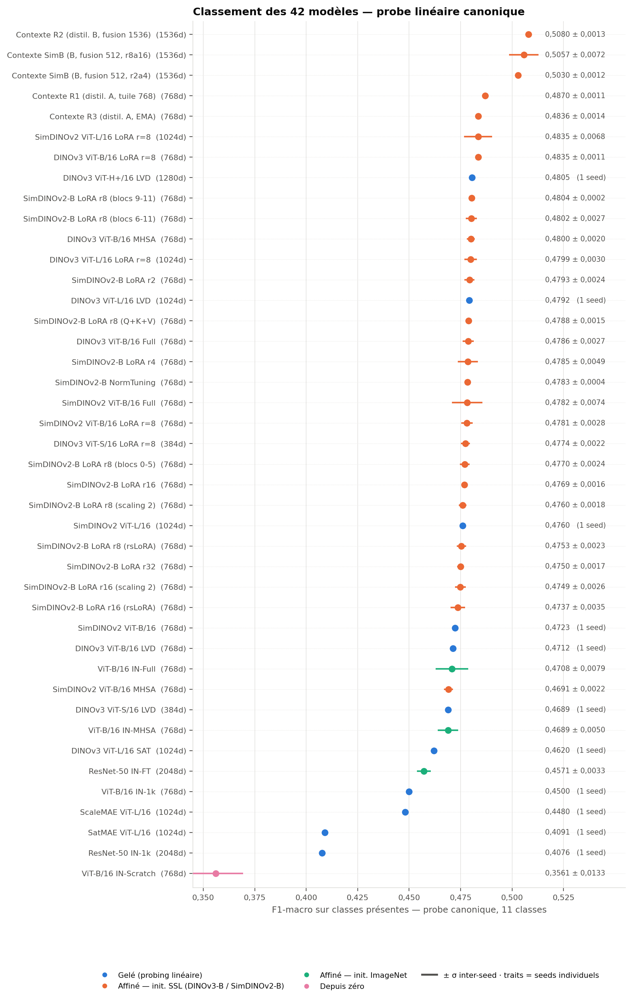
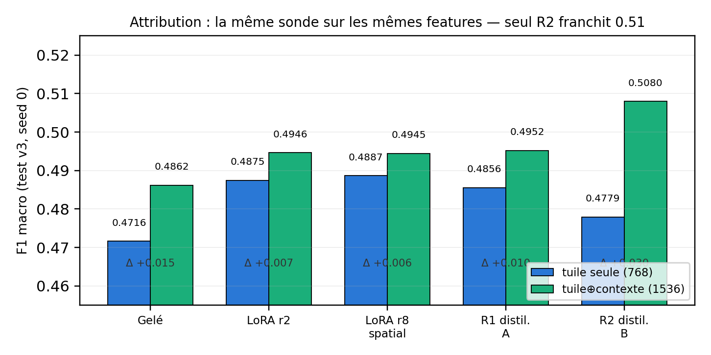
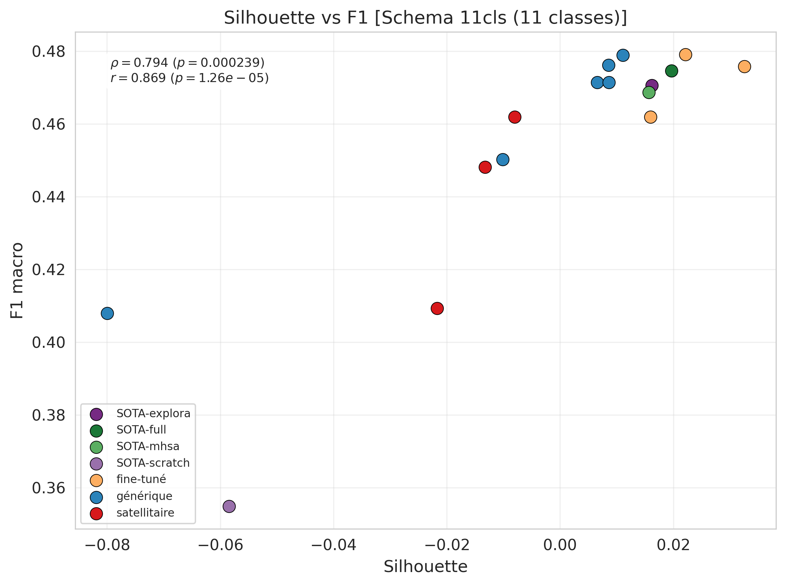
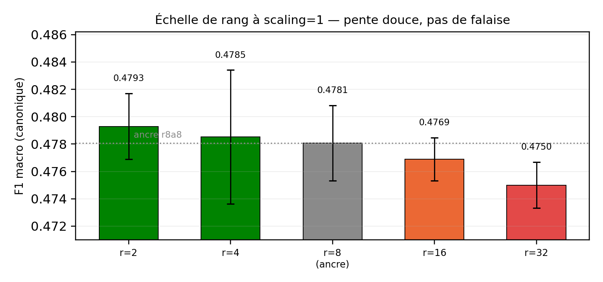
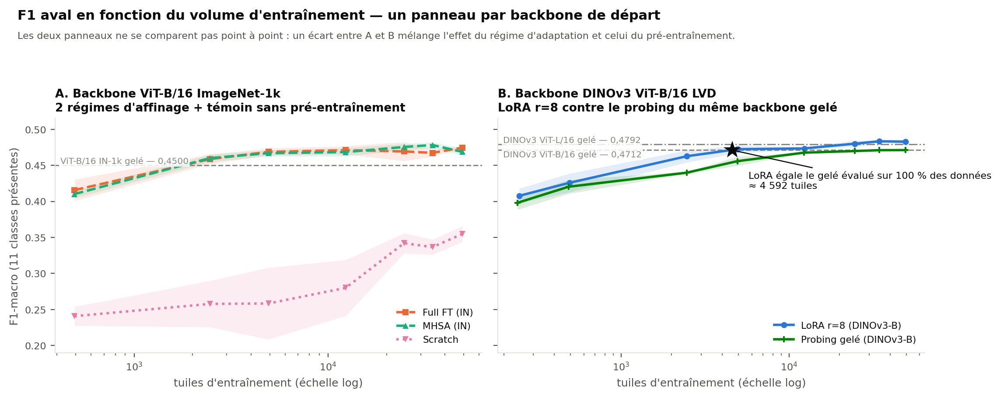
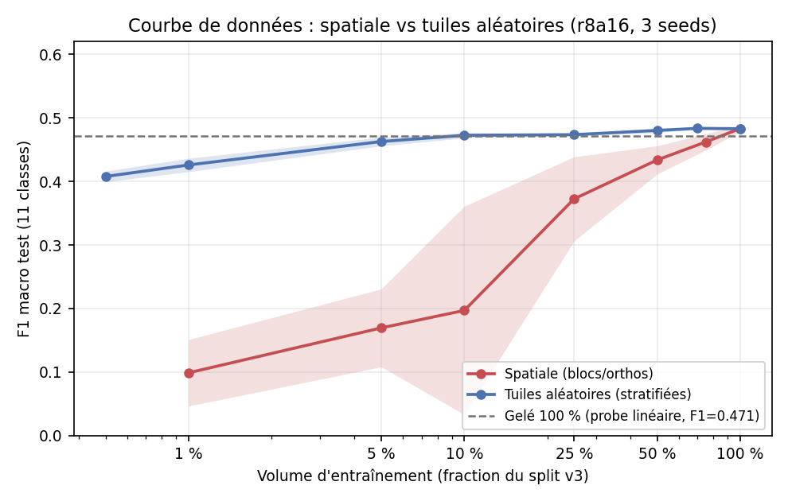
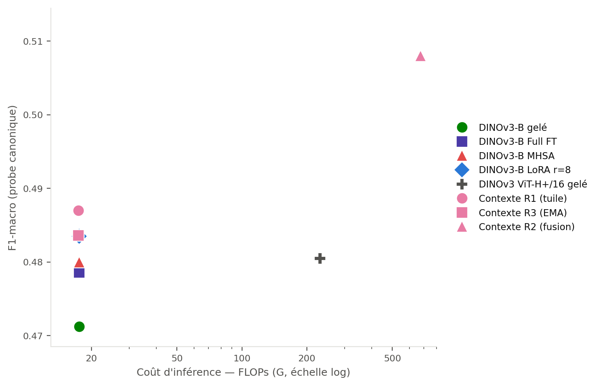

# Arctic tundra vegetation mapping with vision foundation models

This repository holds the code and results of my Master's project at UQAM. The
question was practical. If you want to map Arctic tundra vegetation from drone
imagery, do you need to fine-tune a vision model on your own data, or is a frozen
pretrained backbone good enough?

The short answer is that fine-tuning helps a little, but it does not change the
outcome. The thing that moves the ceiling is spatial context, meaning the
neighbouring area around each tile.

Everything runs on Arctic-TVC, a drone dataset at about 2.2 mm per pixel,
collected at Trail Valley Creek in the Northwest Territories. The task is to
classify small image tiles into vegetation classes.

## The data

38 orthomosaics, 35 of them annotated. The split assigns each whole orthomosaic
to train, validation or test, so no tile from a test orthomosaic can end up in
training.

I report macro F1 over 11 classes. The taxonomy has 12, but RHOL does not appear
in the test split. Three classes (ARCA, DRYI, RUBC) score close to zero for every
model, so the absolute F1 sits below what a cleaner benchmark would give.

## What I ran

42 configurations, all evaluated with the same linear probe on the same split.

- 11 frozen backbones: ResNet-50, ViT-B/16, four DINOv3 sizes, three
  satellite-pretrained models (SatMAE, Scale-MAE, DINOv3-SAT) and two SimDINOv2
  models.
- 31 fine-tuned configurations with three seeds each: full fine-tuning, attention
  only, LoRA at rank 8, training from scratch, and a 13-arm LoRA and PEFT
  ablation.

Fine-tuned models are probed again after training. I drop the head used during
training, extract the embeddings, and fit a new linear probe with the same code as
for the frozen models. The number describes the representation, not the head that
happened to be attached during training.

## The ranking



Macro F1 over the 11 classes present in the test split.

| Model | Regime | F1 |
|---|---|---:|
| Context fusion, learned head (DINOv3-B) | not deployable | 0.5080 |
| SimDINOv2-B, frozen, 512 px context | not deployable | 0.5059 |
| Context distillation, tile only at inference | deployable | ~0.487 |
| DINOv3-L/16, LoRA r=8 | deployable | 0.4842 |
| DINOv3-B, LoRA r=8 | deployable | 0.4835 |
| DINOv3-H+/16, frozen | deployable | 0.4805 |
| DINOv3-L/16 (LVD), frozen | deployable | 0.4792 |
| SimDINOv2-B, norms and head only, 47k params | deployable | 0.4783 |
| SimDINOv2-B, frozen | deployable | 0.4723 |
| DINOv3-B, frozen | deployable | 0.4712 |
| SatMAE ViT-L/16, frozen | deployable | 0.4091 |

The two top entries need the neighbourhood at inference, so they are not
deployable on a single tile. The best deployable configurations sit just above the
best frozen model, by about 0.003 to 0.007.

## What worked

### Spatial context

Fusing each tile with its 512 pixel neighbourhood adds 0.025 to 0.034. It is
positive on 8 of the 9 test orthomosaics. A frozen SimDINOv2-B with a fused
readout reaches 0.5059 without any gradient step.

The controls matter more than the gain. Context alone is no better than the tile
alone (0.4781 against 0.4778), and a permuted context does worse than the tile
alone (0.4745). So the gain comes from the aligned neighbourhood information, not
from the extra pixels or from a larger input dimension.



On five frozen backbones, 512 px beats 1024 px, which beats 2048 px. The effect is
not tied to one architecture.

### Size beats adaptation

At the same architecture, LoRA r=8 sits 0.0114 above its own frozen DINOv3-B on
the pooled test set. The gain is not uniform: it holds on most sites, and one site
loses far more than the others gain. A larger frozen model still wins. The frozen
ViT-L/16 is 0.004 above the frozen ViT-B/16 on 8 of the 9 sites, and full
fine-tuning of the ViT-B/16 ends at 0.4786, just under the frozen ViT-L/16 at
0.4792.

### Separability can shortlist models

Class separability measured on frozen embeddings (Fisher ratio, silhouette,
Calinski-Harabasz, NC1, Davies-Bouldin) orders 64 to 69 percent of model pairs
correctly on the 35-model tier, and keeps working under leave-one-model-out
validation.

It does not predict F1 precisely. It beats the mean of the other models by about
0.0004 of MAE, on a tier whose whole F1 range is about 0.04. It is a shortlisting
tool, not an estimator.



## What did not work

**Fine-tuning the backbone.** It moves a model by about 0.01 and no more.
Thirteen LoRA variants, from rank 2 to 32, with different scalings, block
placements and Q+K+V targets, all land within 0.0067 of each other. Updating only
the normalization layers plus the head, 47k parameters and no adapters, lands
within a thousandth of LoRA rank 8.



**LoRA scaling.** More scaling made things worse, and always in the same
direction. The rsLoRA hypothesis did not hold on these data.

**Non-linear heads.** I tried MLP-2, bilinear-diagonal and FiLM heads. The MLP was
worse than the linear probe in 33 out of 33 groups (mean delta -0.0103). On fused
embeddings, the best non-linear head stayed below lbfgs everywhere (mean delta
-0.0082). The context gain is already in the representation, not something the
classifier was leaving on the table.

**k-NN.** Cosine k-NN was worse than the linear probe on the same embeddings, by
0.031 to 0.104 depending on the model.

**Texture features.** I added 106 handcrafted texture variables (GLCM, wavelets,
Fourier) to the embeddings. No backbone improved, with deltas between -0.002 and
+0.001. The embedding already predicts those texture variables with R2 of at least
0.88, so the residual is flat.

**LogME.** It came out bimodal, about 44,594 for frozen models and 50,689 for
fine-tuned ones. That is not a quality signal, it is the fact that fine-tuned
models saw the labels. Inside a group the spread was 15 units across 21 models, so
it cannot rank.

**Training from scratch.** ViT-B/16 without pretraining reached 0.3561, last of
the ranking. Pretraining is not optional here.

**Satellite pretraining.** SatMAE (0.4091) and Scale-MAE (0.4480) sit at the
bottom. DINOv3-L pretrained on satellite data (0.4620) is clearly behind the same
architecture pretrained on natural images (0.4792). At 2.2 mm per pixel, a
geospatial training corpus is not a good guide.

## What the numbers cannot support

The table above is easy to over-read, so here is what it actually supports.

**Nine test orthomosaics is very few.** The canonical bootstrap resamples tiles,
which treats 17,598 correlated tiles as independent. Rerunning it with the
orthomosaic as the unit raises the mean 95 percent interval on F1 from 0.0142 to
0.1788, about 12.6 times wider.

That 0.1788 is the interval on a model's F1 level. It is not the right yardstick
for comparing two models, because both are measured on the same nine sites and
the site difficulty cancels out. Paired per-site differences are much tighter.
Nine sites is still few, though. With a between-site standard deviation of the
paired difference around 0.03 to 0.05, the smallest effect this design can detect
is roughly 0.03 to 0.05. The spatial context effect sits right at that edge: mean
+0.029, positive on 8 of the 9 sites, but one site goes the other way at -0.078,
so the interval on the mean still includes zero.

**A claim I had to withdraw.** An earlier version of this README said that no
pairwise difference survived a cluster bootstrap over the 42 models. That was
misleading. The bootstrap p-value has a resolution of 0.0002, while the
correction over 595 pairs required 0.00008 at the top rank. Almost nothing could
have survived regardless of the data. The honest reading is not that the models
are equivalent, it is that the tier cannot be ranked at this sample size.

**The ranking depends on how you aggregate.** The numbers here are macro F1 over
all test tiles, so large orthomosaics weigh more. Weight the nine sites equally
instead and some pairs reorder. That is not a bug, but it means any claim about a
specific rank inside the tier should be read as provisional.

**The choice of C is unstable.** A recomputation reproduced 25 of 30 models to
within 0.0005, but three fine-tuned models were underestimated. The clearest case
is DINOv3-L LoRA, recomputed at 0.4842 against 0.4799 published. The whole gap
came from which C the selection kept per seed, not from the embeddings. For the
frozen sweep, validation prefers C = 1e-3 for SimDINOv2-L while the test prefers
C = 1e-4 on all three of its representations, which swaps the SimB and SimL order.
Any claim that one model beats another by 0.005 should be treated as provisional
until the selection rule is frozen.

**Three classes are dead.** ARCA, DRYI and RUBC are near zero for every model, and
RHOL is absent from the test split. Macro F1 is pulled down by classes no model
can learn at this sample size.

## Learning curves and sampling



Fine-tuning a strong backbone costs a lot of data and returns little. LoRA needs
about 4,592 tiles just to match its own frozen backbone, and ends only 0.012 above
it. On the weaker ImageNet backbone the same regimes overtake their frozen
baseline at about 2,060 tiles and gain 0.025 to 0.028.



The random tile draw also flatters results. Under a spatially blocked draw,
performance at 1 percent of the data falls from 0.426 to 0.099. Part of that gap is
simply class coverage: at 1 percent only 3 to 6 classes are present in training.
Restricting the score to the classes that are present raises it to 0.229, so the
drop is first a coverage problem and then a spatial one. The two curves only meet
at 100 percent.

## Cost



LoRA adds no inference cost. The adapters fold into the weights, so a LoRA model
runs exactly like its frozen backbone. DINOv3-B with LoRA r=8 matches the frozen
DINOv3-H+/16 at about one thirteenth of the compute (82 ms against 1123 ms per
image on CPU). The context designs are the expensive ones, because they need a
second forward pass over a larger window.

## Layout

```
src/                Python package (models, probe, metrics, geometry)
scripts/            extraction, probing, analysis, figure generation
configs/            YAML configs for every model and regime
results/            canonical result files
figures/            figures used in this README
probe.py            CLI: linear probe and k-NN
extract.py          CLI: feature extraction
analyze.py          CLI: latent space analysis
train.py            CLI: fine-tuning
make_figures.py     CLI: figure generation
leo-explora-ssl/    separate experiment: unsupervised SSL domain adaptation
```

## What is in this repository, and what is not

Included: code, configs, canonical result JSONs and figures.

Not included: `splits/` (derived from the dataset) and `embeddings/` (regenerate
with `extract.py`, several GB and several hours on CPU). The raw orthomosaics are
available at the FRDR DOI below.

The numbers quoted in this README come from
`results/all_models_canonical_merged.json`. Older directories under `results/` are
kept for provenance and are not authoritative.

## Running it

```bash
pip install -r requirements.txt

# extract features for a frozen model
python extract.py --config configs/frozen_dinov3_lvd.yaml

# linear probe and k-NN
python probe.py --config configs/frozen_eval.yaml

# latent space analysis
python analyze.py --config configs/frozen_eval.yaml
```

Two things cost me time and are worth knowing before you run anything.

The probe forces single-threaded BLAS before importing NumPy. The number of
threads changes the order of the floating point reductions, and lbfgs converges to
a slightly different solution as a result. The measured effect is about 0.0015 of
F1, which is 19 percent of the between-seed standard deviation.

The regularization grid has to be identical across models. The canonical grid has
six points, C in {1e-4, 1e-3, 0.01, 0.1, 1, 10}. The repository also contains
older results from a four-point grid. Those are deprecated and must not be quoted,
and they cannot be compared with the six-point results.

`tests/test_repo_guards.py` checks both rules, plus the Makefile exports, and runs
without external dependencies.

## Data and licence

Arctic-TVC is public on FRDR:
[doi:10.20383/103.01418](https://doi.org/10.20383/103.01418).

Code is under MIT. Figures and results are under CC-BY-4.0. See `LICENSE`.
